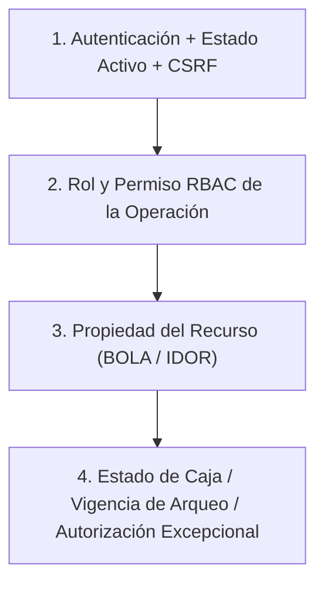

# Matriz de Permisos por Rol y Operación — Sprint 3

**Proyecto:** Amazon Market (`C:\xampp\htdocs\Amazon-Market`)  
**Rama inspeccionada:** `feature/caja` (commit `c29be5a39799379e1af12d2d49ed7128bab25e1c`)  
**Fecha:** 12 de noviembre de 2026  
**Etapa del plan:** Paso 2 — Definir permisos por rol y operación  
**Documento rector de negocio:** [ACUERDOS_Y_PLAN_BACKEND_SPRINT_3.md](file:///c:/xampp/htdocs/Amazon-Market/ACUERDOS_Y_PLAN_BACKEND_SPRINT_3.md)

---

## 1. Alcance del Paso 2 y Referencia Normativa

Este documento completa exclusivamente el **Paso 2** del plan de acción definido en [ACUERDOS_Y_PLAN_BACKEND_SPRINT_3.md](file:///c:/xampp/htdocs/Amazon-Market/ACUERDOS_Y_PLAN_BACKEND_SPRINT_3.md#L209-L227):

- Traducir las responsabilidades aprobadas de **Vendedor** y **Administrador** (HU 11 a HU 19) en controles verificables en el servidor.
- Separar con precisión:
  1. **Autenticación de sesión activa y protección CSRF.**
  2. **Rol y permiso RBAC.**
  3. **Propiedad del recurso (sesión de caja, movimiento, arqueo, solicitud idempotente).**
  4. **Estado de la caja/sesión/arqueo y autorización administrativa excepcional de cierre anticipado.**
- Contrastar la implementación actual del repositorio, los mocks y [CONTRATO_FRONTEND.md](file:///c:/xampp/htdocs/Amazon-Market/CONTRATO_FRONTEND.md) frente a los acuerdos aprobados, prevaleciendo siempre las reglas de [ACUERDOS_Y_PLAN_BACKEND_SPRINT_3.md](file:///c:/xampp/htdocs/Amazon-Market/ACUERDOS_Y_PLAN_BACKEND_SPRINT_3.md).
- Dejar especificados los ajustes de permisos que se incorporarán en `database/tercerSprint` durante el Paso 5, sin ejecutar aún migraciones ni modificar código o base de datos en esta etapa.

---

## 2. Estado Actual de Autenticación, Roles y RBAC (con Evidencias)

### 2.1. Identificadores de roles en base de datos y código

En [amazon_market.sql](file:///c:/xampp/htdocs/Amazon-Market/amazon_market.sql#L677-L690), la tabla `rol` define dos roles activos (`estado = 1`):

| `id_rol` | `nombre` | Uso real en el código |
| :--- | :--- | :--- |
| `1` | `Administrador` | Verificado mediante comparación numérica estricta `(int)$usuario['id_rol'] === 1` o `$_SESSION['rol'] == 1` en [ApiController.php](file:///c:/xampp/htdocs/Amazon-Market/Libraries/Core/ApiController.php#L95-L129), [RBACMiddleware.php](file:///c:/xampp/htdocs/Amazon-Market/Libraries/Middleware/RBACMiddleware.php#L40-L122), [MovimientoInventarioService.php](file:///c:/xampp/htdocs/Amazon-Market/Services/MovimientoInventarioService.php#L76-L78), [CajaController.php](file:///c:/xampp/htdocs/Amazon-Market/Controllers/CajaController.php#L53-L54) y [Header.php](file:///c:/xampp/htdocs/Amazon-Market/Views/Header.php#L61). |
| `2` | `Vendedor` | Rol operativo estándar para cajeros/vendedores en [amazon_market.sql](file:///c:/xampp/htdocs/Amazon-Market/amazon_market.sql#L690) (usuarios `id_usuario` `4`, `6`, `7`, `8`). En [usuarios.js](file:///c:/xampp/htdocs/Amazon-Market/Assets/js/usuarios.js#L231-L237) el frontend evalúa el nombre textual del rol devuelto por la API (`usu.rol`). |

### 2.2. Autenticación de sesión y peligro de reutilizar `AuthService::login()` para autorizaciones

1. **Verificación por petición:**
   - En rutas web (`index.php` líneas 90-103), `AuthMiddleware::handle()` invoca `AuthMiddleware::verificarUsuarioActivoEnSesion()` ([AuthMiddleware.php](file:///c:/xampp/htdocs/Amazon-Market/Libraries/Middleware/AuthMiddleware.php#L15-L55)).
   - En rutas `/api/*`, `ApiController::__construct()` invoca `enforceAuthentication()` ([ApiController.php](file:///c:/xampp/htdocs/Amazon-Market/Libraries/Core/ApiController.php#L65-L77)), que llama a `AuthMiddleware::verificarUsuarioActivoEnSesion()` y almacena `$this->authenticatedUser` y `$this->authenticatedUserId`.
   - `verificarUsuarioActivoEnSesion()` consulta en tiempo real la tabla `usuario` (`INNER JOIN rol`) para confirmar que `estado === 1`. Si el usuario fue desactivado (`estado = 0`), destruye la sesión inmediatamente y responde `401 AUTH_REQUIRED`.

2. **Efecto colateral de `AuthService::login()`:**
   - [AuthService::login()](file:///c:/xampp/htdocs/Amazon-Market/Services/AuthService.php#L15-L38) busca al usuario por `username` (`UsuarioModel::obtenerUsuarioPorUsername()`), verifica `password_verify($password, $user['password_hash'])` y **sobrescribe `$_SESSION`** (`$_SESSION['login'] = true`, `$_SESSION['idUser']`, `$_SESSION['user']`, `$_SESSION['nombre']`, `$_SESSION['rol']`) además de ejecutar `session_regenerate_id(true)`.
   - **Conclusión técnica obligatoria:** **Nunca** debe invocarse `AuthService::login()` para validar la autorización de un administrador en un cierre anticipado, porque reemplazaría la sesión activa del vendedor por la del administrador y además autentica por `username` en vez de `email`.
   - Se observa también una pequeña inconsistencia preexistente: `AuthService::login()` guarda `$_SESSION['user']` ([AuthService.php](file:///c:/xampp/htdocs/Amazon-Market/Services/AuthService.php#L30)), mientras que `AuthMiddleware::verificarUsuarioActivoEnSesion()` sincroniza `$_SESSION['username']` ([AuthMiddleware.php](file:///c:/xampp/htdocs/Amazon-Market/Libraries/Middleware/AuthMiddleware.php#L45)).

3. **Observación sobre `email` de administradores en la base de datos actual:**
   - Según [ACUERDOS_Y_PLAN_BACKEND_SPRINT_3.md](file:///c:/xampp/htdocs/Amazon-Market/ACUERDOS_Y_PLAN_BACKEND_SPRINT_3.md#L148), la autorización de cierre anticipado valida **correo, contraseña y motivo del administrador** contra la BD y su condición de administrador activo (`id_rol = 1`, `estado = 1`).
   - En [amazon_market.sql](file:///c:/xampp/htdocs/Amazon-Market/amazon_market.sql#L848-L854), el usuario `id_usuario = 1` (`username = 'admin'`, `id_rol = 1`) tiene `email = NULL`, mientras que `id_usuario = 9` (`username = 'Superuser'`, `id_rol = 1`) tiene `email = 'supersuer@mail.com'`. Además, la columna `usuario.email` no tiene actualmente restricción `UNIQUE` en `amazon_market.sql` ([amazon_market.sql](file:///c:/xampp/htdocs/Amazon-Market/amazon_market.sql#L1064-L1069)). Esto queda registrado para los Pasos 3 y 5.

### 2.3. Comportamiento actual del RBAC y regla general del rol Administrador

En [RBACMiddleware.php](file:///c:/xampp/htdocs/Amazon-Market/Libraries/Middleware/RBACMiddleware.php#L99-L132) y [Helpers/helpers.php](file:///c:/xampp/htdocs/Amazon-Market/Helpers/helpers.php#L29-L43):

- **Bypass general para `id_rol = 1`:**
  - `RBACMiddleware::tienePermiso(int $rol, string $slug)` devuelve `true` en la línea 113 si el slug no existe en la tabla `permiso` y `$rol === 1`, y vuelve a devolver `true` en la línea 121 (`return $rol === 1;`) aunque el rol `1` **no tenga asignado el permiso en `rol_permiso`**.
  - `RBACMiddleware::getPermisosRol(1)` (líneas 124-128) devuelve **todos** los permisos con `estado = 1` de la tabla `permiso`, sin consultar `rol_permiso`.
  - `can($slug)` y `canAny($slugs)` en `Helpers/helpers.php` devuelven `true` inmediatamente cuando `$_SESSION['rol'] == 1`.

- **Impacto directo en el módulo de Caja:**
  - En [amazon_market.sql](file:///c:/xampp/htdocs/Amazon-Market/amazon_market.sql#L535-L537) existen los permisos:
    - `17`: `turnos.acceder` (`Acceder Turnos`)
    - `18`: `turnos.abrir` (`Abrir Turno`)
    - `19`: `turnos.cerrar` (`Cerrar Turno`)
  - En `rol_permiso` ([amazon_market.sql](file:///c:/xampp/htdocs/Amazon-Market/amazon_market.sql#L707-L733)), los permisos `17`, `18` y `19` están asignados **únicamente** a `id_rol = 2` (Vendedor) y **no** a `id_rol = 1` (Administrador).
  - Sin embargo, debido al bypass general de `RBACMiddleware::tienePermiso()` y `getPermisosRol(1)`, un Administrador (`id_rol = 1`) ve actualmente en el menú lateral ([Views/Header.php](file:///c:/xampp/htdocs/Amazon-Market/Views/Header.php#L145-L174)) las opciones **Abrir caja**, **Movimientos** y **Arqueo y cierre**, y el middleware le permite acceder a esas rutas web.

### 2.4. Permisos actuales en el repositorio y rutas con permisos demasiado generales

| Ruta o Controlador actual | Permiso / Control actual | Evidencia | Problema detectado frente a los acuerdos del Sprint 3 |
| :--- | :--- | :--- | :--- |
| `GET /Caja/abrir` | `turnos.abrir` | [RBACMiddleware.php](file:///c:/xampp/htdocs/Amazon-Market/Libraries/Middleware/RBACMiddleware.php#L192) | El bypass de `id_rol = 1` permite entrar al Administrador aunque `turnos.abrir` solo está en `rol_permiso` para `id_rol = 2`. |
| `GET /Caja/movimientos` | `turnos.acceder` | [RBACMiddleware.php](file:///c:/xampp/htdocs/Amazon-Market/Libraries/Middleware/RBACMiddleware.php#L193) | Usa el mismo permiso general `turnos.acceder` que la consulta de caja y no aparece condicionado por un permiso propio en [Header.php](file:///c:/xampp/htdocs/Amazon-Market/Views/Header.php#L161-L163). |
| `GET /Caja/arqueo` | `turnos.cerrar` | [RBACMiddleware.php](file:///c:/xampp/htdocs/Amazon-Market/Libraries/Middleware/RBACMiddleware.php#L194) | El bypass de `id_rol = 1` concede acceso al Administrador a la pantalla operativa de arqueo y cierre. |
| `GET /Caja/consultar` | `turnos.acceder` | [RBACMiddleware.php](file:///c:/xampp/htdocs/Amazon-Market/Libraries/Middleware/RBACMiddleware.php#L195) | Es una ruta compartida (vista adaptativa según `$_SESSION['rol'] === 1` en [CajaController.php](file:///c:/xampp/htdocs/Amazon-Market/Controllers/CajaController.php#L53-L54)), pero en la capa API necesita separar estrictamente la consulta de sesión activa propia (Vendedor) de la consulta histórica filtrada (Administrador). |
| `GET /Reporte/cierresCaja` y `GET /Reporte/detalleCierreCaja` | `reportes.ver` | [RBACMiddleware.php](file:///c:/xampp/htdocs/Amazon-Market/Libraries/Middleware/RBACMiddleware.php#L217-L218), [ReporteController.php](file:///c:/xampp/htdocs/Amazon-Market/Controllers/ReporteController.php#L23-L56) | No están incluidos en `esRutaExclusivaAdminSprint2` ni invocan verificación de rol Administrador activo en `ReporteController`, a diferencia de `kardex` y `variaciones` ([ReporteController.php](file:///c:/xampp/htdocs/Amazon-Market/Controllers/ReporteController.php#L190-L220)). Además, en [Views/Reporte/index.php](file:///c:/xampp/htdocs/Amazon-Market/Views/Reporte/index.php#L70-L78) la tarjeta se muestra con solo `can('reportes.ver')`. |
| `Views/Usuario/index.php` (Botón Turnos y programación) | `can('usuarios.editar') && can('usuarios.crear')` | [Views/Usuario/index.php](file:///c:/xampp/htdocs/Amazon-Market/Views/Usuario/index.php#L2) | Reutiliza permisos de CRUD de usuarios en vez de un permiso explícito de gestión de turnos y programación semanal, y no exige explícitamente `id_rol = 1`. |
| `GET /api/usuarios` usado desde Movimientos de caja | `usuarios.listar` | [UsuarioApiController.php](file:///c:/xampp/htdocs/Amazon-Market/Controllers/API/UsuarioApiController.php#L20), [cajaMovimientosService.js](file:///c:/xampp/htdocs/Amazon-Market/Assets/js/cajaMovimientosService.js#L316) | El Vendedor no tiene `usuarios.listar` (ni debe tener acceso al directorio completo de usuarios con DNI, teléfono y dirección), pero necesita listar los administradores activos (`id_usuario`, `nombre`) para identificar quién entregó una inyección o recibió un retiro. |

---

## 3. Separación de las 4 Capas de Control en el Servidor

Para evitar que un permiso RBAC genérico o el rol Administrador permitan operar una sesión ajena o alterar saldos indebidamente, toda operación del Sprint 3 en el servidor aplicará cuatro controles independientes y acumulativos:

### Capa 1: Identidad autenticada, usuario activo en BD y CSRF
- Toda petición pasa por `AuthMiddleware::verificarUsuarioActivoEnSesion()` (`estado = 1` en BD) y, si modifica estado (`POST`, `PUT`, `PATCH`, `DELETE`), por `CSRFMiddleware::verifyOrFail()`.
- **Regla anti-suplantación:** El servidor obtiene siempre el identificador del actor desde `$this->authenticatedUserId` (`$_SESSION['idUser']` validado contra BD). Cualquier `vendedor_id`, `seller_id` o `id_usuario` enviado por el cliente en operaciones de vendedor se ignora o, si contradice a `$this->authenticatedUserId`, se rechaza con `403 FORBIDDEN`.

### Capa 2: Rol operativo y permiso RBAC específico
- **Operaciones operativas de caja (HU 11 a HU 16 y consulta activa de HU 17):** Reservadas al vendedor autenticado (`id_rol = 2`) con el permiso RBAC correspondiente (`turnos.abrir`, `turnos.movimientos`, `turnos.arqueo`, `turnos.cerrar`, `turnos.acceder`).
  - *Protección frente al bypass de Administrador:* Aunque `RBACMiddleware::tienePermiso(1, $slug)` devuelva `true` por su regla general, los endpoints de apertura, registro de ingresos/egresos/retiros omitidos, correcciones, arqueos y cierre de caja comprobarán explícitamente el rol operativo y la titularidad de la sesión, impidiendo que un Administrador registre movimientos, arqueos, correcciones o cierres sobre la sesión de un vendedor.
- **Operaciones administrativas (HU 17 histórica, HU 18 turnos/programación y HU 19 reportes/exportaciones):** Reservadas exclusivamente a usuarios activos con `id_rol = 1` (`requireAdminActivo($slug)`), de modo que ni siquiera una asignación accidental en `rol_permiso` otorgue acceso a un `id_rol <> 1`.

### Capa 3: Propiedad del recurso (Prevención de BOLA / IDOR)
- **Sesión de caja (`sesion_caja`):** Para cualquier operación sobre una sesión abierta (ingresos, egresos, retiro omitido, listar corregibles, registrar corrección, guardar/listar arqueos, confirmar cierre, consultar sesión activa), el servidor verifica en base de datos que `sesion_caja.id_usuario_vendedor === $this->authenticatedUserId`.
- **Movimiento original (`movimiento_caja`):** Para registrar una corrección vinculada (HU 15 / HU 16), el servidor verifica que:
  1. El movimiento original pertenezca a la sesión abierta actual del vendedor (`movimiento.id_sesion_caja === sesion_abierta.id_sesion_caja`).
  2. El movimiento original haya sido registrado por el mismo vendedor autenticado (`movimiento.id_usuario_registro === $this->authenticatedUserId`).
  3. El movimiento original sea de un tipo elegible (ingreso manual, inyección de administrador, salida de caja o retiro de administrador), nunca una venta POS, ni un retiro omitido, ni otra corrección.
- **Referencia del cierre anterior vs. historial administrativo:**
  - El Vendedor **solo** puede leer la proyección mínima de referencia necesaria para operar:
    - En **Apertura (HU 11):** monto contado confirmado al cerrar (`efectivo_contado_cierre`), fecha/hora y nombre del turno de la última sesión cerrada de la caja física (o `null` si es la primera apertura histórica).
    - En **Retiro omitido (HU 16):** lista acotada de sesiones cerradas anteriores elegibles con su `id_sesion_caja`, etiqueta de fecha/turno, efectivo esperado, efectivo contado y faltante registrado al cierre, únicamente para vincular la declaración del retiro omitido. No expone el listado de movimientos ni permite editar esa sesión cerrada.
- **Control de solicitudes (`control_solicitud_idempotencia`):** La clave de idempotencia se indexa siempre por `(id_usuario = $this->authenticatedUserId, tipo_operacion, referencia_solicitud)` mediante `ControlSolicitudService`. Un usuario nunca puede consultar ni reutilizar el `request_id` de otro usuario.

### Capa 4: Estado de sesión, vigencia de arqueo y autorización administrativa de cierre anticipado
- **Unicidad de sesión abierta en la única caja física:**
  - Al abrir caja, se verifica con bloqueo transaccional que **no exista ninguna sesión con estado `ABIERTA`** en la caja física (sea del mismo vendedor o de otro).
- **Estado `ABIERTA` obligatorio para operar:**
  - Ingresos, egresos, retiros omitidos, correcciones, arqueos y cierre exigen que la sesión propia esté `ABIERTA`. Una vez confirmada como `CERRADA`, se rechaza cualquier nueva venta POS, movimiento, corrección o arqueo sobre esa sesión.
- **Vigencia del arqueo para cerrar (HU 12 / HU 13):**
  - El cierre exige indicar un `arqueo_id` que pertenezca a la sesión propia, tenga estado `VIGENTE` y cuya versión (`version_caja`) coincida con la versión actual de la sesión de caja. Si entró una venta, ingreso, egreso o corrección posterior al arqueo, el arqueo queda `DESACTUALIZADO` y el cierre se rechaza (`ARQUEO_STALE`) incluso si se enviaron credenciales administrativas válidas.
- **Autorización administrativa excepcional en el cierre anticipado (HU 14):**
  - Se evalúa exclusivamente contra la `hora_fin_referencia` del turno que quedó asociado a la sesión **en el momento de su apertura** (zona horaria `America/Lima`).
  - Sea $T_{\text{fin}}$ el instante de salida del turno asociado a la sesión:
    - Si $T_{\text{actual}} < T_{\text{fin}} - 15\text{ min}$: **Requiere autorización administrativa** (`email`, `password` y `motivo` con contenido).
    - Si $T_{\text{actual}} \ge T_{\text{fin}} - 15\text{ min}$ (incluido el instante exacto de los 15 minutos previos y cualquier hora posterior a $T_{\text{fin}}$, sin límite de 30 minutos): **No requiere autorización administrativa**.
  - Cuando se requiere autorización administrativa, el servidor valida en un método dedicado (sin tocar `$_SESSION`):
    1. Que el `email` corresponda a un usuario en tabla `usuario` con `estado = 1` e `id_rol = 1` (Administrador).
    2. Que `id_usuario` del administrador sea distinto de `$this->authenticatedUserId` (prohibida la autoautorización).
    3. Que `password_verify($password, $admin['password_hash'])` sea verdadero.
    4. Que el `motivo` tenga contenido no vacío tras `trim()`.
    5. Que la sesión de caja sea propia, esté `ABIERTA` y tenga el arqueo `VIGENTE`.
    6. Registra en la misma transacción del cierre la auditoría de autorización (`id_usuario_admin`, `id_usuario_vendedor`, `id_sesion_caja`, `tipo_operacion = 'CIERRE_ANTICIPADO'`, `motivo`, `fecha_hora`) manteniendo intacta la sesión autenticada del vendedor.

---

## 4. Propuesta de Permisos RBAC para el Sprint 3

Para corregir la granularidad insuficiente detectada en la sección 2.4 y conservar los permisos existentes en `amazon_market.sql`, se define el siguiente esquema de slugs (los nuevos se registrarán en `database/tercerSprint` en el Paso 5):

| Slug | Estado | Nombre descriptivo | Rol(es) en `rol_permiso` | Propósito y alcance |
| :--- | :--- | :--- | :--- | :--- |
| `turnos.acceder` | **Existente** (`id=17`) | Acceder al módulo de Caja y consulta activa | Vendedor (`2`), Admin (`1`) | Mostrar el menú `Caja`, acceder a `/Caja/consultar` y consultar el estado/sesión activa propia. |
| `turnos.abrir` | **Existente** (`id=18`) | Abrir sesión de caja | Vendedor (`2`) | Acceder a `/Caja/abrir`, consultar referencia previa y turnos para apertura, y abrir sesión propia. |
| `turnos.movimientos` | **Nuevo (Sprint 3)** | Registrar movimientos y correcciones de caja | Vendedor (`2`) | Acceder a `/Caja/movimientos`, registrar ingresos, egresos, retiros omitidos y correcciones vinculadas sobre sesión propia abierta. |
| `turnos.arqueo` | **Nuevo (Sprint 3)** | Realizar arqueos de caja | Vendedor (`2`) | Consultar y guardar arqueos sobre la sesión propia abierta. (Puede agruparse en la vista `/Caja/arqueo` junto con `turnos.cerrar`). |
| `turnos.cerrar` | **Existente** (`id=19`) | Cerrar sesión de caja | Vendedor (`2`) | Acceder a `/Caja/arqueo`, confirmar el cierre definitivo de la sesión propia y recuperar el cierre confirmado. |
| `turnos.programar` | **Nuevo (Sprint 3)** | Gestionar turnos y programación semanal | Exclusivo Admin (`1`) | Crear/editar/eliminar turnos de atención y consultar/guardar/duplicar la programación semanal de vendedores (HU 18). |
| `turnos.consultar_historico` | **Nuevo (Sprint 3)** | Consultar sesiones históricas y autorizaciones de caja | Exclusivo Admin (`1`) | Listar sesiones por fecha/vendedor/turno y consultar el detalle completo de cualquier sesión y sus autorizaciones en `/Caja/consultar` (HU 17 Admin). |
| `reportes.cierres_caja` | **Nuevo (Sprint 3)** | Consultar reporte de cierres de caja | Exclusivo Admin (`1`) | Acceder a `/Reporte/cierresCaja`, `/Reporte/detalleCierreCaja` y su endpoint de datos (HU 19). |
| `reportes.exportar` | **Existente (Sprint 2)** | Exportar reportes PDF y Excel | Exclusivo Admin (`1`) | Exportar el reporte de cierres de caja a PDF y Excel (combinado con `reportes.cierres_caja` y `requireAdminActivo`). |

> [!IMPORTANT]
> Los slugs `turnos.programar`, `turnos.consultar_historico` y `reportes.cierres_caja` se añadirán a la lista de slugs exclusivos de Administrador en `RBACMiddleware` (`id_rol === 1` obligatorio), siguiendo exactamente el patrón probado en el Sprint 2 con `esSlugExclusivoAdminSprint2()` y `ApiController::requireAdminActivo()`.

---

## 5. Matriz Completa de Permisos por Rol y Operación (HU 11 a HU 19)

### Resumen rápido de operaciones

| # | Operación | HU | Actor que solicita | Rol exigido | Permiso RBAC | Propiedad exigida | Estado de sesión requerido | Autorización Admin adicional |
| :-: | :--- | :-: | :--- | :--- | :--- | :--- | :--- | :--- |
| **OP-01** | Consultar turnos disponibles y programación | HU 11, HU 18 | Vendedor / Admin | `id_rol = 2` o `1` | `turnos.abrir` (Vendedor) / `turnos.programar` (Admin) | Vendedor: solo su programación de hoy y catálogo de turnos activos. Admin: cualquier vendedor. | Indistinto (en apertura: sin sesión abierta) | No |
| **OP-02** | Gestionar turnos (crear, editar, eliminar) | HU 18 | Administrador | Exclusivo `id_rol = 1` | `turnos.programar` | N/A (catálogo global) | No requiere sesión de caja | No (ya es Admin autenticado) |
| **OP-03** | Gestionar programación semanal, duplicar y aplicar alcance (`semana` / `desde`) | HU 18 | Administrador | Exclusivo `id_rol = 1` | `turnos.programar` | Target debe ser usuario con `id_rol = 2` (Vendedor) | No requiere sesión de caja | No (ya es Admin autenticado) |
| **OP-04** | Consultar estado de caja y referencia de apertura | HU 11 | Vendedor | `id_rol = 2` | `turnos.abrir` | Sesión abierta: verifica si es propia o ajena. Referencia previa: solo monto contado, fecha y turno del último cierre. | Sin sesión abierta para habilitar apertura | No |
| **OP-05** | Abrir sesión de caja y registrar suplencia | HU 11 | Vendedor | `id_rol = 2` | `turnos.abrir` | Crea sesión asignada a `$authenticatedUserId` | Caja física sin ninguna sesión `ABIERTA` | **No** (ni fuera de hora ni sin turno ni en suplencia) |
| **OP-06** | Consultar administradores activos para identificar entregas o retiros | HU 15, HU 16 | Vendedor | `id_rol = 2` | `turnos.movimientos` | Solo lectura de proyección mínima (`id_usuario`, `nombre`) de usuarios con `id_rol = 1` y `estado = 1` | Sesión propia `ABIERTA` | No |
| **OP-07** | Registrar ingreso manual e inyección de administrador | HU 15 | Vendedor | `id_rol = 2` | `turnos.movimientos` | `sesion_caja.id_usuario_vendedor === $authenticatedUserId` | Sesión propia `ABIERTA` | **No** (identificar admin en inyección no pide contraseña) |
| **OP-08** | Registrar salida de caja, retiro de administrador y retiro omitido | HU 16 | Vendedor | `id_rol = 2` | `turnos.movimientos` | `sesion_caja.id_usuario_vendedor === $authenticatedUserId` (en retiro omitido referencia sesión anterior cerrada sin editarla) | Sesión propia `ABIERTA` | **No** (basta declaración del vendedor) |
| **OP-09** | Consultar movimientos originales corregibles e historial de correcciones | HU 15, HU 16 | Vendedor | `id_rol = 2` | `turnos.movimientos` | Sesión propia `ABIERTA` y movimientos con `id_usuario_registro === $authenticatedUserId` | Sesión propia `ABIERTA` | No |
| **OP-10** | Registrar corrección vinculada a movimiento propio | HU 15, HU 16 | Vendedor | `id_rol = 2` | `turnos.movimientos` | Sesión propia `ABIERTA` + movimiento original propio (`id_usuario_registro === $authenticatedUserId`) | Sesión propia `ABIERTA` | **No** (prohibido pedir credenciales de admin) |
| **OP-11** | Consultar y guardar arqueos de la sesión | HU 12 | Vendedor | `id_rol = 2` | `turnos.arqueo` / `turnos.cerrar` | `sesion_caja.id_usuario_vendedor === $authenticatedUserId` | Sesión propia `ABIERTA` | No |
| **OP-12** | Confirmar cierre de sesión de caja | HU 13, HU 14 | Vendedor | `id_rol = 2` | `turnos.cerrar` | `sesion_caja.id_usuario_vendedor === $authenticatedUserId` y `arqueo.id_sesion_caja === sesion.id` | Sesión propia `ABIERTA` + Arqueo `VIGENTE` | **Condicional:** Solo si $T_{\text{actual}} < T_{\text{salida}} - 15\text{ min}$ |
| **OP-13** | Validar autorización administrativa de cierre anticipado | HU 14 | Vendedor (presenta credenciales de un Admin) | Solicitante: `id_rol = 2`. Autorizador: `id_rol = 1` activo | `turnos.cerrar` (en el vendedor solicitante) | Sesión propia `ABIERTA` del vendedor; autorizador `id_usuario_admin !== $authenticatedUserId` | Sesión propia `ABIERTA` + Arqueo `VIGENTE` + Cierre antes de los 15 min previos a salida | **Sí** (`email`, `password` y `motivo` del Admin) |
| **OP-14** | Recuperar el resultado de solicitudes propias e idempotencia (`getCierre` / replay) | HU 11 a 16 | Vendedor | `id_rol = 2` | El permiso de la operación original (`turnos.abrir`, `turnos.movimientos`, `turnos.arqueo`, `turnos.cerrar`) | `id_usuario === $authenticatedUserId` (tanto en `control_solicitud_idempotencia` como en la sesión consultada) | `ABIERTA` o `CERRADA` reciente propia (para `getCierre`) | No |
| **OP-15** | Consultar la sesión activa propia y sus movimientos | HU 17 | Vendedor | `id_rol = 2` | `turnos.acceder` | `sesion_caja.id_usuario_vendedor === $authenticatedUserId` | Sesión propia `ABIERTA` | No |
| **OP-16** | Consultar sesiones históricas, movimientos y autorizaciones | HU 17 | Administrador | Exclusivo `id_rol = 1` | `turnos.consultar_historico` | Sin restricción de propiedad (alcance global de auditoría, solo lectura) | `ABIERTA` o `CERRADA` | No |
| **OP-17** | Consultar y exportar reportes de cierres de caja (PDF y Excel) | HU 19 | Administrador | Exclusivo `id_rol = 1` | Consulta: `reportes.cierres_caja`. Exportación: `reportes.cierres_caja` + `reportes.exportar` | Sin restricción de propiedad (solo lectura sobre sesiones cerradas) | Sesiones `CERRADAS` | No |

---

### Detalle por operación (10 puntos normativos por operación)

#### OP-01. Consultar turnos disponibles y programación
1. **HU relacionada:** HU 11 (selección de turno al abrir, incluida suplencia) y HU 18 (gestión de turnos y programación semanal).
2. **Actor que solicita:** Vendedor autenticado (para abrir caja) o Administrador autenticado (en el módulo de Usuarios).
3. **Rol o permiso requerido:**
   - Para apertura de caja (Vendedor): `id_rol = 2` y permiso `turnos.abrir`.
   - Para gestión de programación (Administrador): `id_rol = 1` (`requireAdminActivo('turnos.programar')`).
4. **Datos que puede consultar o modificar:**
   - Solo lectura.
   - **Vendedor:** lista de turnos activos (`id_turno`, `nombre`, `hora_inicio`, `hora_fin`) para poder elegir qué turno atenderá (incluida suplencia) y el turno que tiene programado hoy (`has_shift_today`, turnos asignados hoy y su estado horario informativo). **No** incluye el conteo de vendedores asignados ni la programación de otros vendedores.
   - **Administrador:** catálogo de turnos con total de vendedores asignados (`vendedoresAsignados`) y programación semanal vigente (`turnos`, `dias`, `semanaInicio`, `alcance`) de cualquier vendedor para la semana consultada.
5. **Comprobación de propiedad:**
   - Si el actor es Vendedor, el servidor ignora cualquier `vendedor_id` de la query string y consulta exclusivamente la programación de `$this->authenticatedUserId`.
   - Si el actor es Administrador, puede consultar la programación de cualquier `usuarioId` que pertenezca a un vendedor.
6. **Estado de sesión requerido:** No requiere sesión de caja abierta.
7. **Autorización administrativa adicional:** No requiere.
8. **Restricciones específicas:**
   - La consulta de programación para una semana debe resolver en el servidor si aplica una excepción temporal (`semana`) o la regla base más reciente anterior o igual a esa semana (`desde`).
9. **Componente existente reutilizable o control que falta:**
   - Reutilizable: `ApiController::enforceAuthentication()`, `ApiController::requireAdminActivo()`.
   - Falta crear: modelo/servicio de turnos y programación semanal, y endpoint real que reemplace `UsuariosHorariosService.getTurnos()`, `UsuariosHorariosService.getProgramacion()` ([usuarios-horarios-mock.js](file:///c:/xampp/htdocs/Amazon-Market/Assets/js/usuarios-horarios-mock.js#L96-L169)) y `CajaService.getTurnoDeHoy()` ([cajaService.js](file:///c:/xampp/htdocs/Amazon-Market/Assets/js/cajaService.js#L88-L93)).
10. **Casos de aceptación y rechazo:**
    - *Aceptación:* Vendedor autenticado consulta sus turnos del día y la lista de turnos activos para elegir turno al abrir; recibe `200 OK`.
    - *Aceptación:* Administrador activo consulta la programación de la semana `2026-11-09` del vendedor `id = 4`; recibe los turnos y días vigentes (`200 OK`).
    - *Rechazo:* Vendedor intenta consultar la programación semanal completa de otro vendedor (`usuarioId = 6`) en el endpoint administrativo; recibe `403 FORBIDDEN_ADMIN_ONLY`.

---

#### OP-02. Gestionar turnos (crear, editar, eliminar)
1. **HU relacionada:** HU 18.
2. **Actor que solicita:** Administrador autenticado.
3. **Rol o permiso requerido:** Exclusivo `id_rol = 1` activo + permiso `turnos.programar` (`requireAdminActivo('turnos.programar')`).
4. **Datos que puede consultar o modificar:**
   - Crear turno (`nombre` único, `hora_inicio`, `hora_fin` en formato `HH:mm` de 24h con `fin > inicio`).
   - Editar `nombre`, `hora_inicio` y `hora_fin` de un turno existente conservando sus asignaciones.
   - Eliminar un turno existente únicamente cuando no tenga vendedores asignados ni sesiones comprometidas.
5. **Comprobación de propiedad:** No aplica (recurso de configuración global administrado por `id_rol = 1`).
6. **Estado de sesión requerido:** Independiente del estado de la sesión de caja.
7. **Autorización administrativa adicional:** No requiere credenciales adicionales (la ejecuta el propio Administrador autenticado con CSRF válido).
8. **Restricciones específicas:**
   - Editar las horas de un turno aplica para nuevas aperturas; **nunca** modifica el horario de referencia guardado en sesiones de caja ya abiertas o cerradas ([ACUERDOS_Y_PLAN_BACKEND_SPRINT_3.md](file:///c:/xampp/htdocs/Amazon-Market/ACUERDOS_Y_PLAN_BACKEND_SPRINT_3.md#L68-L71), [Views/Usuario/index.php](file:///c:/xampp/htdocs/Amazon-Market/Views/Usuario/index.php#L157)).
   - Prohibido eliminar un turno con vendedores asignados (`409` / `422`).
9. **Componente existente reutilizable o control que falta:**
   - Reutilizable: `ApiController::requireAdminActivo()`, `CSRFMiddleware::verifyOrFail()`, `Validation`.
   - Falta crear: controlador API y servicio de turnos, registro del permiso `turnos.programar`.
10. **Casos de aceptación y rechazo:**
    - *Aceptación:* Administrador crea el turno `Noche` (`15:00` a `22:00`); se persiste y devuelve `201 Created`.
    - *Rechazo:* Vendedor intenta crear, editar o eliminar un turno; recibe `403 FORBIDDEN_ADMIN_ONLY`.
    - *Rechazo:* Administrador intenta eliminar el turno `Mañana` que tiene vendedores asignados; el servidor rechaza la operación sin borrar el turno.

---

#### OP-03. Gestionar programación semanal, duplicar programación y aplicar cambios temporales o permanentes
1. **HU relacionada:** HU 18.
2. **Actor que solicita:** Administrador autenticado.
3. **Rol o permiso requerido:** Exclusivo `id_rol = 1` activo + permiso `turnos.programar` (`requireAdminActivo('turnos.programar')`).
4. **Datos que puede consultar o modificar:**
   - Guardar la programación semanal de un vendedor (`usuarioId`, `semanaInicio` lunes `YYYY-MM-DD`, arreglo `turnos: [{ turnoId, dias: [0..6] }]`, `alcance: 'semana' | 'desde'`).
   - Asignar varios turnos a un mismo vendedor en un mismo día (ej. Mañana y Tarde el lunes).
   - Duplicar la programación de la semana anterior sobre la semana seleccionada y guardarla con alcance temporal (`semana`, solo esa semana) o permanente (`desde`, nueva base desde esa semana en adelante).
5. **Comprobación de propiedad:**
   - No es propiedad del administrador, pero el servidor debe comprobar que el `usuarioId` objetivo exista en `usuario`, esté activo (`estado = 1`) y tenga rol **Vendedor** (`id_rol = 2`). No se programa horario a usuarios con rol Administrador.
6. **Estado de sesión requerido:** Independiente del estado de la sesión de caja.
7. **Autorización administrativa adicional:** No requiere credenciales adicionales.
8. **Restricciones específicas:**
   - La primera programación de un vendedor establece su base (`alcance = 'desde'`).
   - Un cambio con alcance `semana` crea o actualiza una excepción solo para esa semana; las semanas posteriores vuelven a heredar la base vigente.
   - Un cambio con alcance `desde` actualiza la base desde `semanaInicio` en adelante (reemplazando bases o excepciones futuras desde esa semana) y **conserva intactas las semanas anteriores** y el historial de aperturas/cierres reales ([ACUERDOS_Y_PLAN_BACKEND_SPRINT_3.md](file:///c:/xampp/htdocs/Amazon-Market/ACUERDOS_Y_PLAN_BACKEND_SPRINT_3.md#L55-L61)).
   - Cada `turnoId` debe existir, estar activo, no repetirse dentro de la misma solicitud y tener al menos un día válido (`0` a `6`).
9. **Componente existente reutilizable o control que falta:**
   - Reutilizable: `ApiController::requireAdminActivo()`, `CSRFMiddleware::verifyOrFail()`, `UsuarioModel::obtenerUsuarioPorId()`.
   - Falta crear: tablas de turnos/programaciones en `database/tercerSprint` y servicio de programación semanal. En [Views/Usuario/index.php](file:///c:/xampp/htdocs/Amazon-Market/Views/Usuario/index.php#L2) debe cambiarse `$puedeProgramarHorarios = can('usuarios.editar') && can('usuarios.crear')` por la verificación de rol Administrador y permiso `turnos.programar`.
10. **Casos de aceptación y rechazo:**
    - *Aceptación:* Administrador asigna a un vendedor los turnos `Mañana` y `Tarde` los días lunes a viernes con alcance `desde`; se guarda y aplica a las semanas siguientes.
    - *Aceptación:* Administrador duplica la semana anterior y guarda un cambio con alcance `semana`; solo cambia esa semana y la siguiente mantiene la base.
    - *Rechazo:* Vendedor intenta modificar su propia programación o la de otro vendedor por API; recibe `403 FORBIDDEN_ADMIN_ONLY`.
    - *Rechazo:* Administrador envía un `turnoId` repetido o sin días seleccionados; recibe `422 VALIDATION_ERROR`.

---

#### OP-04. Consultar estado de caja y referencia de apertura
1. **HU relacionada:** HU 11 (y contexto base para HU 12, HU 15, HU 16).
2. **Actor que solicita:** Vendedor autenticado.
3. **Rol o permiso requerido:** `id_rol = 2` (Vendedor activo) + permiso `turnos.abrir` (o `turnos.acceder`).
4. **Datos que puede consultar o modificar:**
   - Solo lectura.
   - Estado de la única caja física:
     - Si no hay sesión abierta: indica `is_open: false`, si existe o no un cierre anterior (`has_previous_close`), y cuando exista cierre anterior, únicamente la **referencia mínima de apertura**: monto de efectivo contado confirmado en ese último cierre (`reference_amount`), fecha del cierre (`reference_date`) y nombre del turno cerrado (`reference_turn`). Si es la **primera apertura histórica** (sin cierre previo), `has_previous_close: false` y `reference_amount: null` (nunca un cero supuesto como cierre anterior).
     - Si ya existe una sesión abierta del **propio** vendedor: devuelve los datos de su sesión abierta (`is_open: true`, `is_owner: true`, `session_id`, turno asociado, horario de referencia, saldo inicial, ventas en efectivo, ingresos, egresos, esperado, tarjeta, Yape/Plin, versión de caja).
     - Si existe una sesión abierta que pertenece a **otro** vendedor: devuelve que la caja física está ocupada (`is_open: true`, `is_owner: false`, nombre del vendedor/turno que la mantiene abierta) **sin exponer** los montos, ventas ni movimientos de esa sesión ajena.
5. **Comprobación de propiedad:**
   - El servidor compara `sesion_abierta.id_usuario_vendedor === $this->authenticatedUserId`.
   - Ignora cualquier `vendedor_id` recibido por query string.
   - **Distinción clave de permisos:** Consultar los 3 datos escalares del cierre anterior (`efectivo_contado`, `fecha_cierre`, `turno`) para mostrar la referencia de apertura **no concede acceso** al listado de cierres históricos ni a los movimientos o diferencias del turno anterior.
6. **Estado de sesión requerido:** Consulta permitida tanto con caja cerrada como abierta (para informar el estado real).
7. **Autorización administrativa adicional:** No requiere.
8. **Restricciones específicas:**
   - En la primera apertura (cuando no hay ningún cierre previo en la BD), no se envía `reference_amount = 0` como si hubiera habido un cierre anterior en cero, sino indicador de primera apertura sin referencia para que la UI no calcule diferencia de apertura ([ACUERDOS_Y_PLAN_BACKEND_SPRINT_3.md](file:///c:/xampp/htdocs/Amazon-Market/ACUERDOS_Y_PLAN_BACKEND_SPRINT_3.md#L75-L80)).
9. **Componente existente reutilizable o control que falta:**
   - Reutilizable: `ApiController::enforceAuthentication()`, `ApiController::requirePermission('turnos.abrir')`.
   - Falta crear: servicio de sesiones de caja y adaptación de `Views/Caja/abrir.php` y `Assets/js/caja.js` para soportar `reference_amount === null` en la primera apertura.
10. **Casos de aceptación y rechazo:**
    - *Aceptación:* Vendedor consulta estado de apertura existiendo un cierre previo de `S/ 200,00`; recibe `reference_amount: 200.00`, fecha y turno, sin acceso a los movimientos de ese cierre.
    - *Aceptación:* Primera apertura histórica; recibe `has_previous_close: false`, `reference_amount: null`.
    - *Rechazo / Restricción de datos:* Si otro vendedor tiene la caja abierta, el servidor informa que la caja está ocupada (`is_owner: false`) y oculta las cifras financieras de la sesión ajena.

---

#### OP-05. Abrir sesión de caja y registrar suplencia
1. **HU relacionada:** HU 11.
2. **Actor que solicita:** Vendedor autenticado.
3. **Rol o permiso requerido:** `id_rol = 2` (Vendedor activo) + permiso `turnos.abrir`.
4. **Datos que puede consultar o modificar:**
   - Crea un nuevo registro en `sesion_caja` con:
     - `id_usuario_vendedor` = `$this->authenticatedUserId` (forzado por el servidor).
     - `id_turno` = turno existente y activo seleccionado por el vendedor al abrir (sea su turno programado o una suplencia).
     - Instantánea del horario del turno seleccionado (`nombre_turno`, `hora_inicio_referencia`, `hora_fin_referencia`) y marcador informativo de si abrió en suplencia o fuera de programación.
     - `fecha_hora_apertura` real del servidor (`America/Lima`).
     - `monto_referencia_cierre_anterior` (`null` si es la primera apertura; de lo contrario, el contado del último cierre confirmado).
     - `efectivo_contado_apertura` = importe confirmado por el vendedor ($\ge 0.00$, hasta 2 decimales), que se convierte en el `saldo_inicial` de la sesión.
     - `diferencia_apertura` = `null` en primera apertura; en aperturas posteriores, `efectivo_contado_apertura - monto_referencia_cierre_anterior` (registrada por separado, sin generar un egreso ni alterar el cierre anterior).
5. **Comprobación de propiedad:**
   - El responsable de la sesión es siempre `$this->authenticatedUserId`, nunca el vendedor que estaba originalmente programado en el turno cubierto ([ACUERDOS_Y_PLAN_BACKEND_SPRINT_3.md](file:///c:/xampp/htdocs/Amazon-Market/ACUERDOS_Y_PLAN_BACKEND_SPRINT_3.md#L69)).
6. **Estado de sesión requerido:**
   - La única caja física **no debe tener ninguna sesión en estado `ABIERTA`** (de ningún vendedor).
7. **Autorización administrativa adicional:**
   - **NO requiere credenciales administrativas en ningún caso**, ni siquiera cuando el vendedor abre fuera de su horario, sin programación para ese día o cubriendo una suplencia ([ACUERDOS_Y_PLAN_BACKEND_SPRINT_3.md](file:///c:/xampp/htdocs/Amazon-Market/ACUERDOS_Y_PLAN_BACKEND_SPRINT_3.md#L65-L70)).
8. **Restricciones específicas:**
   - Es obligatorio seleccionar un `id_turno` activo.
   - Abrir en suplencia no modifica la programación semanal de los vendedores.
   - Protegido por `ControlSolicitudService::ejecutarConIdempotencia($this->authenticatedUserId, 'CAJA_ABRIR', $requestId, ...)`.
9. **Componente existente reutilizable o control que falta:**
   - Reutilizable: `ControlSolicitudService`, `AuthMiddleware::verificarUsuarioActivoEnSesion()`, `CSRFMiddleware::verifyOrFail()`.
   - Falta crear / alinear: eliminar de `Views/Caja/abrir.php`, `Assets/js/caja.js` y `Assets/js/cajaService.js` el bloqueo y el modal de credenciales administrativas en la apertura (`authorizeAndOpen`, `authorization_required`), y añadir el selector del turno que se atenderá cuando corresponda.
10. **Casos de aceptación y rechazo:**
    - *Aceptación:* Vendedor sin turno programado hoy o fuera de horario selecciona el turno `Mañana`, ingresa `S/ 190,00` (con referencia previa de `S/ 200,00`) y confirma apertura **sin contraseña de administrador**; la sesión se abre con saldo inicial `S/ 190,00` y diferencia de apertura `-S/ 10,00`.
    - *Rechazo:* Vendedor intenta abrir sesión cuando otro vendedor (o él mismo) aún no ha cerrado la sesión anterior de la única caja física; el servidor rechaza con `409 CASH_ALREADY_OPEN`.
    - *Rechazo:* Importe negativo, con más de dos decimales o sin turno seleccionado; el servidor rechaza con `422 VALIDATION_ERROR`.

---

#### OP-06. Consultar administradores para identificar entregas o retiros
1. **HU relacionada:** HU 15 (inyección del administrador) y HU 16 (retiro del administrador y retiro omitido).
2. **Actor que solicita:** Vendedor autenticado.
3. **Rol o permiso requerido:** `id_rol = 2` (Vendedor activo) + permiso `turnos.movimientos` (o `turnos.acceder`).
4. **Datos que puede consultar o modificar:**
   - Solo lectura.
   - Lista exclusivamente los usuarios con `id_rol = 1` (Administrador) y `estado = 1` (activos), devolviendo **únicamente** `id_usuario` y `nombre` (o etiqueta visible).
   - **Prohibido exponer:** `password_hash`, `dni`, `telefono`, `direccion`, ni usuarios con rol Vendedor o inactivos.
5. **Comprobación de propiedad:**
   - Requiere que el vendedor solicitante tenga una sesión de caja propia en estado `ABIERTA` (o acceso válido al formulario de movimientos).
6. **Estado de sesión requerido:** Sesión propia `ABIERTA`.
7. **Autorización administrativa adicional:** No requiere.
8. **Restricciones específicas:**
   - No debe reutilizarse directamente `GET /api/usuarios` con `usuarios.listar`, porque `UsuarioApiController::get()` exige el permiso administrativo `usuarios.listar` y expone datos personales completos de todos los usuarios ([UsuarioApiController.php](file:///c:/xampp/htdocs/Amazon-Market/Controllers/API/UsuarioApiController.php#L20-L79)). Debe exponerse una acción específica de catálogo de caja (ej. en el controlador API de caja).
9. **Componente existente reutilizable o control que falta:**
   - Reutilizable: `UsuarioModel` (agregando un método `obtenerAdministradoresActivosParaCaja()` que seleccione solo `id_usuario, nombre WHERE id_rol = 1 AND estado = 1`).
   - Falta crear: endpoint de catálogo para caja autorizado con `turnos.movimientos`.
10. **Casos de aceptación y rechazo:**
    - *Aceptación:* Vendedor con sesión abierta carga la pestaña de ingresos/egresos; recibe la lista `[{ id: 1, name: "Admin" }, ...]` con `200 OK`.
    - *Rechazo:* Vendedor intenta invocar `GET /api/usuarios` general para listar DNI y teléfonos de todo el personal; recibe `403 FORBIDDEN`.

---

#### OP-07. Registrar ingreso manual e inyección de administrador
1. **HU relacionada:** HU 15.
2. **Actor que solicita:** Vendedor autenticado.
3. **Rol o permiso requerido:** `id_rol = 2` (Vendedor activo) + permiso `turnos.movimientos`.
4. **Datos que puede consultar o modificar:**
   - Inserta un movimiento en `movimiento_caja` vinculado a la sesión abierta del vendedor y aumenta el saldo de efectivo esperado de la sesión en `+monto` e incrementa la `version_caja` (dejando `DESACTUALIZADO` cualquier arqueo vigente previo).
   - Campos: `tipo_movimiento` (`INGRESO_MANUAL` o `INYECCION_ADMIN`), `monto` ($> 0.00$, hasta 2 decimales), `motivo` obligatorio con contenido, `id_usuario_admin_referencia` (obligatorio en `INYECCION_ADMIN`, `NULL` en `INGRESO_MANUAL`), `id_usuario_registro` = `$this->authenticatedUserId`.
5. **Comprobación de propiedad:**
   - La sesión abierta debe pertenecer al vendedor autenticado (`sesion_caja.id_usuario_vendedor === $this->authenticatedUserId`).
6. **Estado de sesión requerido:** Sesión propia en estado `ABIERTA` (verificada con bloqueo `SELECT ... FOR UPDATE` sobre `sesion_caja`).
7. **Autorización administrativa adicional:**
   - **NO requiere credenciales administrativas.** Seleccionar al administrador que entregó el efectivo en una inyección es un dato de trazabilidad del movimiento, no una autorización con contraseña ([ACUERDOS_Y_PLAN_BACKEND_SPRINT_3.md](file:///c:/xampp/htdocs/Amazon-Market/ACUERDOS_Y_PLAN_BACKEND_SPRINT_3.md#L29), [ACUERDOS_Y_PLAN_BACKEND_SPRINT_3.md](file:///c:/xampp/htdocs/Amazon-Market/ACUERDOS_Y_PLAN_BACKEND_SPRINT_3.md#L97-L100)).
8. **Restricciones específicas:**
   - Cuando el tipo es `INYECCION_ADMIN`, el servidor comprueba en BD que `id_usuario_admin_referencia` exista, tenga `id_rol = 1` y `estado = 1`.
   - No se permite registrar ventas normales del POS como ingresos manuales; las ventas entran automáticamente desde `VentaService`.
   - Idempotencia obligatoria mediante `ControlSolicitudService`.
9. **Componente existente reutilizable o control que falta:**
   - Reutilizable: `ControlSolicitudService::ejecutarConIdempotencia()`, transacción PDO con `SELECT ... FOR UPDATE`.
   - Falta crear: servicio y modelo de movimientos de caja.
10. **Casos de aceptación y rechazo:**
    - *Aceptación:* Vendedor registra inyección de `S/ 50,00` indicando `administrator_id = 1` y motivo `"Cambio para caja"` sin contraseña de admin; el saldo sube en `S/ 50,00`.
    - *Rechazo:* Vendedor intenta registrar una inyección sin `administrator_id` o con un `administrator_id` que pertenece a un vendedor (`id_rol = 2`) o usuario inactivo; el servidor rechaza con `422 ADMINISTRATOR_REQUIRED` sin alterar el saldo.
    - *Rechazo:* Vendedor intenta registrar un ingreso cuando su sesión ya está cerrada o cuando la sesión abierta pertenece a otro vendedor; el servidor rechaza con `409 CASH_CLOSED` / `403 SESSION_NOT_OWNED`.

---

#### OP-08. Registrar egreso (salida de caja), retiro de administrador y retiro omitido del turno anterior
1. **HU relacionada:** HU 16.
2. **Actor que solicita:** Vendedor autenticado.
3. **Rol o permiso requerido:** `id_rol = 2` (Vendedor activo) + permiso `turnos.movimientos`.
4. **Datos que puede consultar o modificar:**
   - **Subtipo A — Salida de caja (`SALIDA_CAJA`) y Retiro del administrador (`RETIRO_ADMIN`):**
     - Registra el egreso en la sesión abierta actual y **resta** `monto` del saldo disponible de efectivo (`efecto_saldo = -monto`), incrementando `version_caja`.
     - En `RETIRO_ADMIN` exige `id_usuario_admin_referencia` válido (`id_rol = 1`, `estado = 1`).
   - **Subtipo B — Retiro omitido del turno anterior (`RETIRO_OMITIDO`):**
     - Documenta en la sesión actual un retiro de efectivo ocurrido mientras una sesión anterior estaba abierta y que no fue registrado antes de cerrarla.
     - Registra: `monto` ($> 0.00$), `motivo` obligatorio, `id_usuario_admin_referencia` (administrador que recibió el dinero, obligatorio), `id_sesion_origen` (sesión cerrada anterior donde ocurrió el retiro) y `declaracion_reflejado_apertura` (`confirm_previous_open = true`).
     - **Efecto sobre el cierre anterior:** No edita ni reescribe ningún importe del cierre anterior (`sesion_origen` conserva sus cifras originales de esperado, contado y diferencia de cierre).
     - **Efecto sobre la sesión actual:** Cuando la declaración deja constancia de que esa salida ya estaba reflejada en el efectivo contado al abrir la sesión actual, el movimiento se registra con **impacto cero (`efecto_saldo = 0.00`)** sobre el saldo actual de la caja ([ACUERDOS_Y_PLAN_BACKEND_SPRINT_3.md](file:///c:/xampp/htdocs/Amazon-Market/ACUERDOS_Y_PLAN_BACKEND_SPRINT_3.md#L117-L125)).
   - **Consulta auxiliar para Retiro omitido (`listClosedTurns`):**
     - El vendedor con sesión abierta puede consultar la lista de sesiones cerradas anteriores elegibles con su resumen mínimo (`id_sesion_caja`, fecha/turno, `expected`, `counted`, `shortage`) para seleccionar el turno de origen, aunque esa sesión anterior haya sido atendida por otro vendedor.
5. **Comprobación de propiedad:**
   - La sesión activa donde se registra la operación debe pertenecer al vendedor autenticado (`sesion_caja.id_usuario_vendedor === $this->authenticatedUserId`).
   - En un `RETIRO_OMITIDO`, la `id_sesion_origen` referenciada puede haber pertenecido al mismo vendedor o a otro vendedor (relevo de turno), pero la operación **solo crea un registro en la sesión actual con vínculo de referencia** a `id_sesion_origen`; jamás permite modificar movimientos ni cifras de la sesión ajena o cerrada.
6. **Estado de sesión requerido:**
   - Sesión actual propia en estado `ABIERTA`.
   - En `RETIRO_OMITIDO`, la sesión referenciada en `id_sesion_origen` debe existir y estar en estado `CERRADA`.
7. **Autorización administrativa adicional:**
   - **NO requiere credenciales administrativas** para ninguno de los tres subtipos (tampoco para el retiro omitido: basta la declaración del vendedor autenticado).
8. **Restricciones específicas:**
   - En `SALIDA_CAJA` y `RETIRO_ADMIN`, el `monto` no puede superar el saldo de efectivo disponible actual de la sesión (`monto <= saldo_actual`). Un egreso exactamente igual al saldo disponible (`monto == saldo_actual`) **es válido** y deja el saldo en `S/ 0,00` ([ACUERDOS_Y_PLAN_BACKEND_SPRINT_3.md](file:///c:/xampp/htdocs/Amazon-Market/ACUERDOS_Y_PLAN_BACKEND_SPRINT_3.md#L98)).
   - Prohibido usar egresos o retiros omitidos para cuadrar un faltante físico cuya causa se desconoce.
   - Idempotencia obligatoria mediante `ControlSolicitudService`.
9. **Componente existente reutilizable o control que falta:**
   - Reutilizable: `ControlSolicitudService`, bloqueo transaccional `FOR UPDATE`.
   - Falta crear: validación de saldo disponible exacto a 2 decimales y persistencia del vínculo `id_sesion_origen` en `movimiento_caja`.
10. **Casos de aceptación y rechazo:**
    - *Aceptación:* Saldo actual `S/ 100,00`; vendedor registra salida de caja por `S/ 100,00` con motivo válido; se acepta y el nuevo saldo queda en `S/ 0,00`.
    - *Aceptación:* Vendedor entrante declara un retiro omitido de `S/ 300,00` del turno anterior cerrado por Marta, indicando el administrador que recibió el dinero, el turno de origen, motivo y confirmación de que ya estaba reflejado en el conteo de apertura, **sin contraseña de administrador**; se registra vinculado al turno anterior, el cierre de Marta conserva sus cifras originales y el saldo actual del vendedor entrante cambia en `S/ 0,00`.
    - *Rechazo:* Saldo actual `S/ 100,00`; vendedor intenta registrar un retiro de administrador por `S/ 100,01`; el servidor rechaza con `409 INSUFFICIENT_BALANCE` e informa el saldo actual sin modificarlo.
    - *Rechazo:* Vendedor intenta registrar un retiro omitido sin seleccionar `origin_turn_id`, sin `administrator_id` o sin marcar la declaración `confirm_previous_open`; el servidor rechaza con `422`.

---

#### OP-09. Consultar movimientos originales corregibles e historial de correcciones
1. **HU relacionada:** HU 15 y HU 16.
2. **Actor que solicita:** Vendedor autenticado.
3. **Rol o permiso requerido:** `id_rol = 2` (Vendedor activo) + permiso `turnos.movimientos`.
4. **Datos que puede consultar o modificar:**
   - Solo lectura.
   - Devuelve `{ movements: [...], corrections: [...] }` correspondientes únicamente a la **sesión abierta actual del vendedor autenticado**:
     - `movements`: ingresos manuales, inyecciones de administrador, salidas de caja y retiros de administrador confirmados en la sesión actual y registrados por el propio vendedor, incluyendo `id`, `type`, `label`, `amount` (importe original inmutable), `current_amount` (importe vigente tras correcciones previas), `reference`, `reason`, `recorded_at`, `status`.
     - `corrections`: historial cronológico de correcciones vinculadas registradas en esa misma sesión (`id`, `original_movement_id`, `original_amount`, `previous_corrected_amount`, `corrected_amount`, `reason`, `effect`, `recorded_at`, `responsible`).
5. **Comprobación de propiedad:**
   - Verifica que `sesion_caja.id_usuario_vendedor === $this->authenticatedUserId` y filtra `movimiento_caja.id_usuario_registro === $this->authenticatedUserId`.
   - Ignora o valida estrictamente cualquier `session_id` recibido por query string contra la sesión abierta propia.
6. **Estado de sesión requerido:** Sesión propia `ABIERTA`.
7. **Autorización administrativa adicional:** No requiere.
8. **Restricciones específicas:**
   - No incluye como movimientos corregibles: ventas del POS, retiros omitidos ni registros de corrección ([CONTRATO_FRONTEND.md](file:///c:/xampp/htdocs/Amazon-Market/CONTRATO_FRONTEND.md#L282-L283), [ACUERDOS_Y_PLAN_BACKEND_SPRINT_3.md](file:///c:/xampp/htdocs/Amazon-Market/ACUERDOS_Y_PLAN_BACKEND_SPRINT_3.md#L102-L111)).
9. **Componente existente reutilizable o control que falta:**
   - Reutilizable: `ApiController::enforceAuthentication()`, `ApiController::requirePermission('turnos.movimientos')`.
   - Falta crear: consulta en modelo/servicio de movimientos de caja.
10. **Casos de aceptación y rechazo:**
    - *Aceptación:* Vendedor con sesión abierta consulta sus movimientos corregibles; recibe únicamente los ingresos y egresos propios elegibles de su sesión actual y sus correcciones vinculadas.
    - *Rechazo:* Vendedor envía el `session_id` de una sesión cerrada o de otro vendedor; el servidor rechaza con `403` / `409 CASH_CLOSED`.

---

#### OP-10. Registrar corrección vinculada a movimiento propio
1. **HU relacionada:** HU 15 y HU 16.
2. **Actor que solicita:** Vendedor autenticado.
3. **Rol o permiso requerido:** `id_rol = 2` (Vendedor activo) + permiso `turnos.movimientos`.
4. **Datos que puede consultar o modificar:**
   - **No edita ni elimina la fila original** en `movimiento_caja` (su importe original permanece intacto).
   - Inserta un nuevo registro de corrección vinculado a `id_movimiento_original` (y al eslabón previo si hubo una corrección anterior sobre el mismo movimiento), guardando:
     - `id_movimiento_original`
     - `importe_original`
     - `importe_vigente_previo` (`before`)
     - `importe_correcto` (`corrected_amount`, $\ge 0.00$, hasta 2 decimales)
     - `ajuste_calculado` (calculado exclusivamente por el servidor: si el original era ingreso/inyección, $\text{efecto} = \text{importe\_correcto} - \text{importe\_vigente\_previo}$; si el original era salida/retiro, $\text{efecto} = \text{importe\_vigente\_previo} - \text{importe\_correcto}$)
     - `motivo` obligatorio identificando el error y la evidencia
     - `id_usuario_registro` = `$this->authenticatedUserId`
   - Actualiza el saldo esperado de la sesión por el `ajuste_calculado` (nunca duplicando el importe original) e incrementa `version_caja` (invalidando arqueos vigentes previos).
5. **Comprobación de propiedad:**
   - Comprobación doble obligatoria en el servidor:
     1. La sesión debe pertenecer al vendedor autenticado (`sesion_caja.id_usuario_vendedor === $this->authenticatedUserId`).
     2. El movimiento original debe pertenecer a esa sesión y haber sido registrado por el mismo vendedor autenticado (`movimiento_original.id_usuario_registro === $this->authenticatedUserId`).
6. **Estado de sesión requerido:** Sesión propia en estado `ABIERTA`.
7. **Autorización administrativa adicional:**
   - **NO requiere credenciales administrativas.** [ACUERDOS_Y_PLAN_BACKEND_SPRINT_3.md](file:///c:/xampp/htdocs/Amazon-Market/ACUERDOS_Y_PLAN_BACKEND_SPRINT_3.md#L109) establece expresamente: *"No se piden credenciales administrativas para corregir movimientos propios"*.
8. **Restricciones específicas:**
   - Si el ajuste calculado reduce el efectivo disponible de la sesión (por ejemplo, reducir un ingreso de `S/ 50,00` a `S/ 10,00` cuando el saldo actual es `S/ 25,00`, lo que implicaría restar `S/ 40,00`), el servidor debe verificar que el saldo resultante no quede negativo (`saldo_actual + ajuste_calculado >= 0.00`).
   - Prohibido corregir movimientos de sesiones cerradas, movimientos de otros vendedores, ventas POS o retiros omitidos.
   - Idempotencia obligatoria mediante `ControlSolicitudService`.
9. **Componente existente reutilizable o control que falta:**
   - Reutilizable: `ControlSolicitudService::ejecutarConIdempotencia()`.
   - Falta crear / alinear: en el frontend actual ([Views/Caja/movimientos.php](file:///c:/xampp/htdocs/Amazon-Market/Views/Caja/movimientos.php#L206-L219), [Assets/js/cajaMovimientos.js](file:///c:/xampp/htdocs/Amazon-Market/Assets/js/cajaMovimientos.js#L514-L564), [Assets/js/cajaMovimientosService.js](file:///c:/xampp/htdocs/Amazon-Market/Assets/js/cajaMovimientosService.js#L237-L242) y [CONTRATO_FRONTEND.md](file:///c:/xampp/htdocs/Amazon-Market/CONTRATO_FRONTEND.md#L274-L326)) todavía se piden `admin_username` y `admin_password`. Esos campos deben retirarse en el Paso 13 y el backend no debe exigirlos.
10. **Casos de aceptación y rechazo:**
    - *Aceptación:* Vendedor registró un ingreso propio de `S/ 50,00` por error de digitación cuando debió ser `S/ 30,00`; envía corrección con `corrected_amount = 30.00` y motivo válido **sin credenciales administrativas**; el original de `S/ 50,00` se conserva, se inserta la corrección vinculada y el servidor reduce el saldo en `-S/ 20,00`.
    - *Rechazo:* Vendedor intenta corregir un movimiento cuyo `id_movimiento_original` pertenece a otra sesión o fue registrado por otro vendedor; el servidor rechaza con `403 FORBIDDEN` / `MOVEMENT_NOT_FOUND` sin alterar el saldo.
    - *Rechazo:* Vendedor intenta corregir un movimiento de una sesión ya cerrada; el servidor rechaza con `409 CASH_CLOSED`.

---

#### OP-11. Consultar y guardar arqueos de la sesión
1. **HU relacionada:** HU 12.
2. **Actor que solicita:** Vendedor autenticado.
3. **Rol o permiso requerido:** `id_rol = 2` (Vendedor activo) + permiso `turnos.arqueo` (o `turnos.cerrar`).
4. **Datos que puede consultar o modificar:**
   - **Consultar (`getArqueos` / `getState`):** devuelve el desglose financiero actual de la sesión propia (`opening_fund`, `cash_sales`, `income`, `expenses`, `expected`, `card`, `yape_plin`, `version`) y el historial cronológico completo de arqueos de la sesión (`id`, `date`, `time`, `counted`, `difference`, `observation`, `status`: `Vigente`, `Reemplazado` o `Desactualizado`, `version`).
   - **Guardar arqueo (`guardarArqueo`):**
     - Verifica que la `version` enviada por el cliente coincida con la `version_caja` actual de la sesión. Si hubo una venta, ingreso, egreso o corrección concurrente, rechaza con `409 CASH_CHANGED` devolviendo el nuevo `expected` y la nueva `version`.
     - Calcula en el servidor `esperado = saldo_inicial + ventas_efectivo + ingresos_efectivo - egresos_efectivo` y `diferencia = contado - esperado` (a 2 decimales).
     - Si existía un arqueo previo en estado `Vigente`, pasa su estado a `Reemplazado` (sin eliminarlo ni sobrescribir sus datos) e inserta el nuevo arqueo con estado `Vigente` y la `version_caja` actual.
5. **Comprobación de propiedad:**
   - La sesión debe pertenecer al vendedor autenticado (`sesion_caja.id_usuario_vendedor === $this->authenticatedUserId`).
6. **Estado de sesión requerido:** Sesión propia en estado `ABIERTA` para guardar arqueos. (En consulta, si la sesión acaba de cerrarse, puede devolver su historial en solo lectura).
7. **Autorización administrativa adicional:** No requiere.
8. **Restricciones específicas:**
   - `counted` admite desde `0.00` con hasta dos decimales.
   - Si `diferencia !== 0.00`, la `observation` con contenido no vacío es **obligatoria** (`422 OBSERVATION_REQUIRED`).
   - Ningún arqueo se construye solo en el navegador: solo es válido para el cierre el arqueo confirmado y persistido por el servidor.
   - Idempotencia obligatoria mediante `ControlSolicitudService`.
9. **Componente existente reutilizable o control que falta:**
   - Reutilizable: `ControlSolicitudService`, bloqueo `FOR UPDATE` sobre `sesion_caja`.
   - Falta crear: tabla `arqueo_caja` en `database/tercerSprint` y servicio de arqueos.
10. **Casos de aceptación y rechazo:**
    - *Aceptación:* Esperado `S/ 300,00`; vendedor guarda conteo `S/ 295,00` con observación `"Faltan S/ 5,00 en monedas"`; el servidor marca el arqueo anterior como `Reemplazado` y guarda el nuevo como `Vigente` con diferencia `-S/ 5,00`.
    - *Rechazo:* Diferencia distinta de cero y observación vacía; el servidor rechaza con `422 OBSERVATION_REQUIRED`.
    - *Rechazo:* Mientras el vendedor tenía la pantalla abierta (`version = 3`), se confirma una venta en efectivo (`version` sube a `4`); al pulsar guardar arqueo con `version = 3`, el servidor rechaza con `409 CASH_CHANGED` y devuelve el nuevo esperado para que el vendedor revise antes de guardar.

---

#### OP-12. Confirmar cierre de sesión de caja
1. **HU relacionada:** HU 13 y HU 14.
2. **Actor que solicita:** Vendedor autenticado.
3. **Rol o permiso requerido:** `id_rol = 2` (Vendedor activo) + permiso `turnos.cerrar`.
4. **Datos que puede consultar o modificar:**
   - Confirma de forma atómica el cierre definitivo de la sesión abierta del vendedor:
     - Cambia el estado de la sesión a `CERRADA`.
     - Registra `fecha_hora_cierre` real del servidor (`America/Lima`).
     - Vincula el `id_arqueo_cierre` (el arqueo `Vigente` utilizado).
     - Congela las cifras confirmadas del cierre: `saldo_inicial`, `total_ventas_efectivo`, `total_ventas_tarjeta`, `total_ventas_yape_plin`, `total_ingresos`, `total_egresos`, `efectivo_esperado_cierre`, `efectivo_contado_cierre`, `diferencia_cierre`, `observacion_cierre`.
     - Bloquea inmediatamente cualquier nueva venta POS, movimiento, corrección o arqueo sobre esa sesión.
5. **Comprobación de propiedad:**
   - `sesion_caja.id_usuario_vendedor === $this->authenticatedUserId`.
   - El `arqueo_id` enviado debe pertenecer a esa misma sesión (`arqueo.id_sesion_caja === sesion_caja.id_sesion_caja`).
6. **Estado de sesión requerido:**
   - Sesión propia en estado `ABIERTA`.
   - El `arqueo_id` debe estar en estado `Vigente` y su `version_caja` debe coincidir con la `version_caja` actual de la sesión (ninguna operación posterior al arqueo).
7. **Autorización administrativa adicional:**
   - **Condicional según la regla de los 15 minutos respecto al turno asociado en la apertura:**
     - Sea $T_{\text{fin}}$ la hora de salida del turno seleccionado cuando se abrió la sesión:
       - Si la hora actual del servidor es **anterior** a $T_{\text{fin}} - 15\text{ min}$ (p. ej. `11:44:59` para un turno que sale a las `12:00:00`): **Sí requiere autorización administrativa** (ver OP-13). Si la petición no incluye las credenciales y motivo del administrador, el servidor responde `403`/`409` con código `AUTHORIZATION_REQUIRED` y el horario de referencia del turno, sin cerrar la sesión.
       - Si la hora actual del servidor es **mayor o igual** a $T_{\text{fin}} - 15\text{ min}$ (p. ej. desde las `11:45:00` en adelante, incluyendo las `12:00:00` y cualquier hora posterior como `12:45` o `15:00`, **sin límite posterior de 30 minutos**): **No requiere autorización administrativa**.
8. **Restricciones específicas:**
   - No se evalúa el horario contra el turno que esté transcurriendo según el reloj al momento de cerrar, sino siempre contra el turno que quedó asociado a la sesión al abrirla ([ACUERDOS_Y_PLAN_BACKEND_SPRINT_3.md](file:///c:/xampp/htdocs/Amazon-Market/ACUERDOS_Y_PLAN_BACKEND_SPRINT_3.md#L68), [ACUERDOS_Y_PLAN_BACKEND_SPRINT_3.md](file:///c:/xampp/htdocs/Amazon-Market/ACUERDOS_Y_PLAN_BACKEND_SPRINT_3.md#L143-L146)).
   - No se genera ni expone ticket individual imprimible/descargable de cierre ([ACUERDOS_Y_PLAN_BACKEND_SPRINT_3.md](file:///c:/xampp/htdocs/Amazon-Market/ACUERDOS_Y_PLAN_BACKEND_SPRINT_3.md#L20), [ACUERDOS_Y_PLAN_BACKEND_SPRINT_3.md](file:///c:/xampp/htdocs/Amazon-Market/ACUERDOS_Y_PLAN_BACKEND_SPRINT_3.md#L154)).
   - Idempotencia obligatoria mediante `ControlSolicitudService`.
9. **Componente existente reutilizable o control que falta:**
   - Reutilizable: `ControlSolicitudService`, transacciones PDO.
   - Falta crear: lógica de evaluación de ventana de 15 minutos sobre el turno de apertura y persistencia del cierre.
10. **Casos de aceptación y rechazo:**
    - *Aceptación (11:45 para salida 12:00):* Turno asociado termina a las `12:00`; a las `11:45:00` el vendedor confirma el cierre con arqueo vigente y **sin credenciales de administrador**; el servidor confirma el cierre (`200`/`201 CLOSE_CONFIRMED`).
    - *Aceptación (después de las 12:00):* Turno asociado termina a las `12:00`; a las `13:10` el vendedor confirma el cierre con arqueo vigente y **sin credenciales de administrador**; el servidor confirma el cierre sin aplicar ningún límite posterior de 30 minutos.
    - *Rechazo (11:44 para salida 12:00 sin credenciales):* A las `11:44:00` el vendedor pulsa confirmar cierre sin credenciales de administrador; el servidor no cierra la caja y responde `AUTHORIZATION_REQUIRED`.
    - *Rechazo (arqueo desactualizado):* El vendedor intenta cerrar con un `arqueo_id` que quedó `Desactualizado` por una venta posterior; el servidor rechaza con `409 ARQUEO_STALE` sin cerrar la sesión.

---

#### OP-13. Validar autorización administrativa de cierre anticipado
1. **HU relacionada:** HU 14 (y HU 13).
2. **Actor que solicita:** Vendedor autenticado (quien mantiene su sesión en el navegador y presenta en el formulario de excepción el correo, la contraseña y el motivo del Administrador que autoriza presencialmente).
3. **Rol o permiso requerido:**
   - **Usuario autenticado en sesión (`$_SESSION['idUser']`):** Vendedor activo (`id_rol = 2`) con permiso `turnos.cerrar`.
   - **Usuario autorizador (credenciales en el cuerpo de la petición):** Administrador activo en BD (`id_rol = 1`, `estado = 1`).
4. **Datos que puede consultar o modificar:**
   - Verifica las credenciales del administrador en BD (`email`, `password`) y el `motivo` de la excepción.
   - Si todas las validaciones de autorización, propiedad de sesión y vigencia de arqueo se cumplen, registra conjuntamente en la misma transacción:
     1. El registro auditable en `autorizacion_caja` (`id_sesion_caja`, `id_arqueo`, `id_usuario_vendedor` = `$this->authenticatedUserId`, `id_usuario_admin` = `$admin['id_usuario']`, `tipo_operacion = 'CIERRE_ANTICIPADO'`, `motivo`, `fecha_hora_autorizacion`).
     2. El cierre definitivo de la sesión de caja (OP-12).
5. **Comprobación de propiedad:**
   - `sesion_caja.id_usuario_vendedor === $this->authenticatedUserId`.
   - `admin.id_usuario !== $this->authenticatedUserId` (un usuario jamás puede autorizarse a sí mismo, incluso en el supuesto de que tuviera permisos especiales).
   - `arqueo.id_sesion_caja === sesion_caja.id_sesion_caja`.
6. **Estado de sesión requerido:**
   - Sesión propia en estado `ABIERTA`.
   - Arqueo indicado en estado `Vigente` y con `version_caja` igual a la versión actual de la sesión.
7. **Autorización administrativa adicional:**
   - **Es el objeto mismo de esta operación**, aplicable **única y exclusivamente** al cierre anticipado ($T_{\text{actual}} < T_{\text{fin}} - 15\text{ min}$).
   - **Prohibido habilitar este endpoint para aperturas (`operation = 'open'`), ingresos, egresos, correcciones o retiros omitidos.**
8. **Restricciones específicas:**
   - **Validación sin mutar `$_SESSION`:** Se implementará un método dedicado (p. ej. `AuthService::verificarCredencialesAdministradorPorEmail(string $email, string $password, int $idVendedorSolicitante)`) que:
     1. Busque en `usuario` por `LOWER(TRIM(email)) = LOWER(TRIM(:email))` (sin usar `AuthService::login()`).
     2. Compruebe que el usuario exista, tenga `estado === 1`, tenga `id_rol === 1` y su `id_usuario !== $idVendedorSolicitante`.
     3. Compruebe `password_verify($password, $admin['password_hash'])`.
     4. **No modifique ninguna clave de `$_SESSION` ni regenere el ID de sesión**, preservando intacta la sesión del vendedor autenticado.
   - **Orden de transacción y atomicidad:** Si el arqueo está `Desactualizado` (`ARQUEO_STALE`) o la sesión ya está cerrada, aunque el correo y la contraseña del administrador sean válidos, **toda la operación se rechaza**, no se cierra la caja y no queda una autorización huérfana aplicada.
   - Al calcular el hash de idempotencia en `ControlSolicitudService`, debe excluirse `admin_password` en texto plano del JSON persistido en `control_solicitud_idempotencia` por seguridad.
9. **Componente existente reutilizable o control que falta:**
   - Reutilizable: `password_verify()` nativo de PHP, `Conexion`, `ControlSolicitudService`.
   - Falta crear / alinear:
     - Método `UsuarioModel::obtenerUsuarioPorEmail(string $email)` y `AuthService::verificarCredencialesAdministradorPorEmail(...)`.
     - Actualizar `Views/Caja/_autorizacion.php` ([_autorizacion.php](file:///c:/xampp/htdocs/Amazon-Market/Views/Caja/_autorizacion.php#L13-L17)), `Assets/js/cajaArqueo.js` y `Assets/js/cajaArqueoService.js` para solicitar y enviar el **correo electrónico (`admin_email`)** del administrador en lugar de `admin_username`, conforme a [ACUERDOS_Y_PLAN_BACKEND_SPRINT_3.md](file:///c:/xampp/htdocs/Amazon-Market/ACUERDOS_Y_PLAN_BACKEND_SPRINT_3.md#L148).
10. **Casos de aceptación y rechazo:**
    - *Aceptación:* Turno termina a las `12:00`; a las `11:44` el vendedor solicita cierre con arqueo vigente, correo y contraseña válidos de un administrador activo y motivo `"Emergencia médica del vendedor"`; el servidor valida al administrador, mantiene la sesión del vendedor, guarda la autorización y confirma el cierre.
    - *Rechazo (credenciales inválidas o usuario inactivo):* Se ingresa contraseña incorrecta, o el correo pertenece a un administrador con `estado = 0` o a un vendedor (`id_rol = 2`); el servidor rechaza con `403 INVALID_ADMIN_CREDENTIALS` / `ADMIN_ROLE_REQUIRED`, no modifica la sesión del vendedor ni cierra la caja.
    - *Rechazo (autorización válida pero arqueo desactualizado):* A las `11:40` se envían credenciales válidas de administrador, pero una venta ocurrió después del último arqueo; el servidor rechaza con `409 ARQUEO_STALE`, no cierra la sesión y exige realizar un nuevo arqueo.

---

#### OP-14. Recuperar el resultado de solicitudes propias (`getCierre` y replay idempotente)
1. **HU relacionada:** HU 11, HU 12, HU 13, HU 14, HU 15, HU 16.
2. **Actor que solicita:** Vendedor autenticado.
3. **Rol o permiso requerido:** `id_rol = 2` (Vendedor activo) + el permiso correspondiente a la operación (`turnos.abrir`, `turnos.movimientos`, `turnos.arqueo`, `turnos.cerrar`).
4. **Datos que puede consultar o modificar:**
   - **Replay idempotente en `POST` (`ControlSolicitudService`):** Si el vendedor reenvía la misma solicitud (`referencia_solicitud` / `request_id`) con el mismo payload tras una caída de conexión, el servidor devuelve `200 OK` (`idempotent_replay: true`) con el resultado original confirmado, sin volver a insertar ni duplicar el efecto en el saldo.
   - **Consulta puntual del cierre propio (`getCierre(sesionId)` en HU 13):** Permite al vendedor recuperar el resumen confirmado (`expected`, `counted`, `difference`, `observation`, `closed_at`) de la sesión propia que acaba de cerrar para reconciliar fallos de red antes de anunciar éxito en pantalla.
5. **Comprobación de propiedad:**
   - En `ControlSolicitudService`: `control_solicitud_idempotencia.id_usuario === $this->authenticatedUserId` ([ControlSolicitudService.php](file:///c:/xampp/htdocs/Amazon-Market/Services/ControlSolicitudService.php#L127-L141)).
   - En `getCierre(sesionId)`: `sesion_caja.id_usuario_vendedor === $this->authenticatedUserId`.
   - **Restricción crítica de alcance:** Recuperar el resumen del cierre propio recién ejecutado (`getCierre`) **no habilita** al vendedor a listar ni consultar el historial de cierres anteriores propios ni de otros vendedores ([ACUERDOS_Y_PLAN_BACKEND_SPRINT_3.md](file:///c:/xampp/htdocs/Amazon-Market/ACUERDOS_Y_PLAN_BACKEND_SPRINT_3.md#L33)).
6. **Estado de sesión requerido:** Para `getCierre`, la sesión propia consultada puede estar `CERRADA` (devuelve el resumen) o `ABIERTA` (devuelve `null` indicando que el cierre aún no se persistió).
7. **Autorización administrativa adicional:** No requiere.
8. **Restricciones específicas:**
   - Si se reenvía el mismo `request_id` pero con datos diferentes (p. ej. distinto monto o distinto `arqueo_id`), `ControlSolicitudService` rechaza con `409 IDEMPOTENCY_PAYLOAD_MISMATCH`.
   - Si la primera petición aún se está ejecutando en paralelo, `GET_LOCK(..., 0)` / estado `EN_PROCESO` rechaza el duplicado simultáneo con `409 REQUEST_IN_PROGRESS`.
9. **Componente existente reutilizable o control que falta:**
   - Reutilizable directamente: [Services/ControlSolicitudService.php](file:///c:/xampp/htdocs/Amazon-Market/Services/ControlSolicitudService.php) y tabla `control_solicitud_idempotencia` creada en el Sprint 2.
   - Falta crear: excluir `admin_password` del cálculo de hash/almacenamiento en `ControlSolicitudService::calcularHashPayload()` y crear el endpoint de lectura acotada `getCierre` para la sesión propia.
10. **Casos de aceptación y rechazo:**
    - *Aceptación:* El vendedor confirma un ingreso o un cierre, se corta la red antes de recibir la respuesta y reintenta con el mismo `request_id`; recibe el mismo resultado confirmado (`idempotent_replay: true`) y el saldo se afecta una sola vez.
    - *Rechazo:* El vendedor intenta consultar `getCierre` pasando el `sesion_id` de otro vendedor; el servidor rechaza con `403 FORBIDDEN`.

---

#### OP-15. Consultar la sesión activa propia
1. **HU relacionada:** HU 17 (vista Vendedor).
2. **Actor que solicita:** Vendedor autenticado.
3. **Rol o permiso requerido:** `id_rol = 2` (Vendedor activo) + permiso `turnos.acceder`.
4. **Datos que puede consultar o modificar:**
   - Solo lectura.
   - Resumen completo de su **única sesión actualmente `ABIERTA`** (`opening_balance`, `cash_sales`, `income`, `expenses`, `current_balance`, y separados `card`, `yape_plin`) más la lista paginada en orden cronológico de todos los movimientos de esa sesión (`fecha_hora`, `tipo`, `motivo_referencia`, `importe`, `efecto_saldo`, `responsable`).
   - Los totales del resumen corresponden siempre al conjunto completo de la sesión activa, no solo a la página visible.
5. **Comprobación de propiedad:**
   - El servidor busca exclusivamente la sesión con `id_usuario_vendedor === $this->authenticatedUserId` y `estado === 'ABIERTA'`.
   - No acepta parámetros de filtro por `seller_id`, `date` ni `session_id` de sesiones cerradas.
6. **Estado de sesión requerido:** Sesión propia `ABIERTA` (si el vendedor no tiene sesión abierta actualmente, devuelve estado `NO_OPEN_SESSION` / `empty` con enlace para ir a Abrir caja, sin cargar sesiones cerradas anteriores).
7. **Autorización administrativa adicional:** No requiere.
8. **Restricciones específicas:**
   - Una sesión recién abierta sin movimientos ni ventas devuelve su `opening_balance` como `current_balance` y `0.00` en los acumuladores de movimientos ([ACUERDOS_Y_PLAN_BACKEND_SPRINT_3.md](file:///c:/xampp/htdocs/Amazon-Market/ACUERDOS_Y_PLAN_BACKEND_SPRINT_3.md#L174)).
9. **Componente existente reutilizable o control que falta:**
   - Reutilizable: `CajaController::consultar()` ([CajaController.php](file:///c:/xampp/htdocs/Amazon-Market/Controllers/CajaController.php#L52-L77)), `Views/Caja/consultar.php` y `Assets/js/cajaConsulta.js`.
   - Falta crear: endpoint API `caja/consulta/activa` conectado a base de datos real.
10. **Casos de aceptación y rechazo:**
    - *Aceptación:* Vendedor con sesión abierta entra a `Consultar caja`; visualiza su saldo inicial, ventas en efectivo, ingresos, egresos, saldo actual y movimientos paginados.
    - *Rechazo:* Vendedor sin sesión abierta hoy (aunque haya cerrado una hace 10 minutos) entra a `Consultar caja`; el servidor responde `NO_OPEN_SESSION` y no le muestra su sesión cerrada anterior como si fuera un historial libre.

---

#### OP-16. Consultar sesiones históricas, movimientos y autorizaciones (Administrador)
1. **HU relacionada:** HU 17 (vista Administrador) y HU 14 (consulta de evidencia de autorizaciones).
2. **Actor que solicita:** Administrador autenticado.
3. **Rol o permiso requerido:** Exclusivo `id_rol = 1` activo + permiso `turnos.consultar_historico` (`requireAdminActivo('turnos.consultar_historico')`).
4. **Datos que puede consultar o modificar:**
   - Solo lectura.
   - **Paso 1 (`listSellers` y `listSessions`):**
     - Lista los vendedores registrados para el filtro.
     - Lista todas las sesiones de caja (abiertas o cerradas) cuya **fecha local de apertura** (`America/Lima`) coincida con `date` y pertenezcan a `seller_id` (con opción de filtrar por turno en la interfaz cuando existan al menos dos turnos distintos).
   - **Paso 2 (`query` de una sesión seleccionada `session_id`):**
     - Devuelve los datos de la sesión seleccionada (`session_id`, vendedor responsable real que abrió, turno asociado, horario de referencia, estado `Abierta` o `Cerrada`, `opened_at`, `closed_at`, `opening_difference`), el resumen financiero completo de toda la sesión, las **autorizaciones registradas** (administrador que autorizó, vendedor, operación, motivo, fecha y hora) y los movimientos paginados en orden cronológico indicando responsable (vendedor y administrador que entregó/recibió cuando aplique).
5. **Comprobación de propiedad:**
   - No restringida a sesiones propias: el Administrador audita sesiones de cualquier vendedor, pero **en modo estrictamente de solo lectura**.
6. **Estado de sesión requerido:** Permite consultar tanto sesiones `ABIERTA` (actuales) como `CERRADA` (históricas).
7. **Autorización administrativa adicional:** No requiere (el solicitante ya es un Administrador autenticado y activo).
8. **Restricciones específicas:**
   - No se combinan saldos de distintas sesiones del mismo día ni se selecciona silenciosamente la última cuando existen varias aperturas: se exige seleccionar explícitamente el `session_id`.
   - Si no existen aperturas para la fecha y el vendedor filtrados, devuelve lista vacía (`[]`) sin sustituirla por datos de otra fecha o sesión ([ACUERDOS_Y_PLAN_BACKEND_SPRINT_3.md](file:///c:/xampp/htdocs/Amazon-Market/ACUERDOS_Y_PLAN_BACKEND_SPRINT_3.md#L175)).
9. **Componente existente reutilizable o control que falta:**
   - Reutilizable: `ApiController::requireAdminActivo()`, `Views/Caja/consultar.php`, `Assets/js/cajaConsulta.js`, `Assets/js/cajaConsultaService.js`.
   - Falta crear: endpoints `caja/consulta/vendedores`, `caja/consulta/sesiones` y `caja/consulta` protegidos con `requireAdminActivo('turnos.consultar_historico')`.
10. **Casos de aceptación y rechazo:**
    - *Aceptación:* Un vendedor abrió dos sesiones el mismo día (turno Mañana cerrada y turno Tarde abierta); el Administrador filtra por esa fecha y vendedor, ve ambas sesiones, elige una y consulta sus totales, autorizaciones y movimientos paginados.
    - *Rechazo:* Un Vendedor (`id_rol = 2`) intenta llamar por URL directa a `GET /api/caja/consulta/sesiones?date=2026-11-10&seller_id=6` o `GET /api/caja/consulta?session_id=10`; el servidor rechaza con `403 FORBIDDEN_ADMIN_ONLY`.

---

#### OP-17. Consultar y exportar reportes de cierres de caja (PDF y Excel)
1. **HU relacionada:** HU 19.
2. **Actor que solicita:** Administrador autenticado.
3. **Rol o permiso requerido:**
   - **Para consultar la vista web y los datos filtrados del reporte:** Exclusivo `id_rol = 1` activo + permiso `reportes.cierres_caja` (`requireAdminActivo('reportes.cierres_caja')`).
   - **Para exportar a PDF o Excel:** Exclusivo `id_rol = 1` activo + ambos permisos `reportes.cierres_caja` y `reportes.exportar`.
4. **Datos que puede consultar o modificar:**
   - Solo lectura sobre sesiones en estado `CERRADA`.
   - Filtros por rango de **fecha de cierre** (`desde`, `hasta`), `turno` y `vendedor`.
   - En la tabla y en el detalle de cada cierre ([Views/Reporte/cierresCaja.php](file:///c:/xampp/htdocs/Amazon-Market/Views/Reporte/cierresCaja.php) y [Views/Reporte/detalleCierreCaja.php](file:///c:/xampp/htdocs/Amazon-Market/Views/Reporte/detalleCierreCaja.php)): muestra por separado `opening_fund` (fondo inicial), `cash_sales`, `income`, `expenses`, `expected` (efectivo esperado), `counted` (efectivo contado), `closing_difference` (diferencia de cierre), `opening_difference` (diferencia de apertura separada), ventas por otros medios (`card_sales`, `digital_sales`), observación del arqueo, datos de la autorización de horario (si hubo cierre anticipado autorizado), indicador de retiro omitido vinculado y el listado de movimientos de la sesión con sus referencias a correcciones o retiros omitidos sin reescribir cierres anteriores.
   - En exportación a PDF y Excel: incluye el conjunto completo de cierres que cumplen el filtro (no solo la página actual de la tabla) y sus cifras consolidadas, según los diseños que entregará el usuario en el Paso 14.
5. **Comprobación de propiedad:** No aplica (alcance administrativo global de solo lectura).
6. **Estado de sesión requerido:** Solo incluye sesiones `CERRADA`.
7. **Autorización administrativa adicional:** No requiere credenciales adicionales.
8. **Restricciones específicas:**
   - Exclusión explícita: no existe ticket individual de cierre imprimible/descargable para el vendedor; PDF y Excel son reportes administrativos del período filtrado (HU 19).
   - Ante un error de exportación, se responde con código de error controlado para que la interfaz conserve los filtros y permita reintentar ([ACUERDOS_Y_PLAN_BACKEND_SPRINT_3.md](file:///c:/xampp/htdocs/Amazon-Market/ACUERDOS_Y_PLAN_BACKEND_SPRINT_3.md#L180)).
9. **Componente existente reutilizable o control que falta:**
   - Reutilizable:
     - Patrón de protección de Kardex/Variaciones en `RBACMiddleware::esRutaExclusivaAdminSprint2()`, `RBACMiddleware::esSlugExclusivoAdminSprint2()`, `ReporteController` y `ReporteApiController` ([ReporteApiController.php](file:///c:/xampp/htdocs/Amazon-Market/Controllers/API/ReporteApiController.php#L43-L62), [ReporteApiController.php](file:///c:/xampp/htdocs/Amazon-Market/Controllers/API/ReporteApiController.php#L155-L188), [ReporteApiController.php](file:///c:/xampp/htdocs/Amazon-Market/Controllers/API/ReporteApiController.php#L411-L436)).
     - Librerías corporativas `Libraries/PDF/ReportPDF.php` (FPDF) y `Libraries/Excel/OpenSpout` para cuando el usuario entregue los diseños en el Paso 14.
   - Falta crear / corregir:
     - En [RBACMiddleware.php](file:///c:/xampp/htdocs/Amazon-Market/Libraries/Middleware/RBACMiddleware.php#L75-L97) y `mapControllerMethodToSlug()` (líneas 217-218): agregar `cierrescaja` y `detallecierrecaja` como rutas exclusivas de Administrador asociadas al slug `reportes.cierres_caja`.
     - En [ReporteController.php](file:///c:/xampp/htdocs/Amazon-Market/Controllers/ReporteController.php#L23-L56): exigir sesión activa y `id_rol === 1` en `cierresCaja()` y `detalleCierreCaja()`, igual que en `kardex()` y `variaciones()`.
     - En [Views/Reporte/index.php](file:///c:/xampp/htdocs/Amazon-Market/Views/Reporte/index.php#L70-L78): condicionar la tarjeta de Cierres de caja a `$rol == 1 && can('reportes.cierres_caja')`.
10. **Casos de aceptación y rechazo:**
    - *Aceptación:* Administrador filtra cierres del `2026-10-01` al `2026-10-20`, consulta el detalle de un cierre y exporta el período a PDF y Excel; recibe la información completa con `200 OK`.
    - *Rechazo:* Vendedor (`id_rol = 2`) intenta acceder a `/Reporte/cierresCaja`, `/Reporte/detalleCierreCaja/101` o a `/api/reportes/exportar-pdf?tipo=cierres-caja`; el servidor rechaza con `403 FORBIDDEN_ADMIN_ONLY` (o redirección a `/Home` en ruta web) sin filtrar datos.

---

### Integración transversal con Ventas POS (`VentaApiController` / `VentaService` — Paso 9)

Aunque el procesamiento de ventas pertenece a `ventas.procesar`, el acuerdo de la Sección 7 de [ACUERDOS_Y_PLAN_BACKEND_SPRINT_3.md](file:///c:/xampp/htdocs/Amazon-Market/ACUERDOS_Y_PLAN_BACKEND_SPRINT_3.md#L127-L132) impacta directamente los controles de sesión de caja:
- Cuando un usuario autenticado confirma una venta en `POST /api/ventas` ([VentaApiController.php](file:///c:/xampp/htdocs/Amazon-Market/Controllers/API/VentaApiController.php#L85-L109)):
  1. El servidor toma `$data['id_usuario'] = (int)$this->authenticatedUserId` (ya implementado en línea 96).
  2. Debe comprobar dentro de la misma transacción de `VentaService::procesarVenta()` que exista una **sesión de caja `ABIERTA` perteneciente a ese usuario** (`sesion_caja.id_usuario_vendedor === $idUsuario`), asociar `venta.id_sesion_caja`, incrementar el acumulador del medio de pago correspondiente (si es Efectivo, aumenta el saldo esperado de efectivo; si es Tarjeta o Yape/Plin, se acumula por separado sin sumar al efectivo) e incrementar `version_caja` (dejando `Desactualizado` cualquier arqueo vigente previo).
  3. Si la sesión de caja está cerrada o pertenece a otro vendedor, la venta no puede confirmarse sobre esa sesión.

---

## 6. Mapa de Componentes Existentes Reutilizables vs. Controles Faltantes

| Componente existente | Ubicación | Cómo se reutilizará en el Sprint 3 | Qué ajuste o extensión requiere |
| :--- | :--- | :--- | :--- |
| **`AuthMiddleware::verificarUsuarioActivoEnSesion()`** | [Libraries/Middleware/AuthMiddleware.php](file:///c:/xampp/htdocs/Amazon-Market/Libraries/Middleware/AuthMiddleware.php#L15-L55) | Verifica en cada petición web y API que el usuario autenticado exista en BD con `estado = 1` y sincroniza `id_rol`, `username` y `nombre`. | Ninguno en su lógica base; garantiza que usuarios dados de baja pierdan acceso de inmediato. |
| **`CSRFMiddleware`** | [Libraries/Middleware/CSRFMiddleware.php](file:///c:/xampp/htdocs/Amazon-Market/Libraries/Middleware/CSRFMiddleware.php#L28-L85) | Valida el token `X-CSRF-Token` en todas las peticiones `POST`, `PUT`, `PATCH`, `DELETE` de `/api/*` (`index.php` línea 108 y `ApiController::enforceCsrfOnStateChange()`). | Ninguno; `Assets/js/api.js` ya envía la cabecera CSRF automáticamente. |
| **`ApiController`** | [Libraries/Core/ApiController.php](file:///c:/xampp/htdocs/Amazon-Market/Libraries/Core/ApiController.php#L92-L147) | Provee `$this->authenticatedUserId`, `$this->authenticatedUser`, `requirePermission($slug)` y `requireAdminActivo($slug)`. | Agregar un helper protegido (p. ej. `requireVendedorActivo(string $slug): array`) o validación explícita para las operaciones operativas de caja y ampliar el reconocimiento de slugs exclusivos de Admin del Sprint 3. |
| **`RBACMiddleware`** | [Libraries/Middleware/RBACMiddleware.php](file:///c:/xampp/htdocs/Amazon-Market/Libraries/Middleware/RBACMiddleware.php#L75-L228) | Resuelve permisos por ruta web y por slug API. | 1. Añadir a las rutas/slugs exclusivos de Admin: `reporte/cierrescaja`, `reporte/detallecierrecaja`, `turnos.programar`, `turnos.consultar_historico`, `reportes.cierres_caja`. 2. Mapear `caja/movimientos` a `turnos.movimientos`. 3. Evitar que el bypass `$rol === 1` en `tienePermiso()` habilite a un Administrador a operar sesiones de caja de vendedores. |
| **`ControlSolicitudService`** | [Services/ControlSolicitudService.php](file:///c:/xampp/htdocs/Amazon-Market/Services/ControlSolicitudService.php#L95-L266) | Resuelve idempotencia, bloqueos no bloqueantes (`GET_LOCK(..., 0)`) y recuperación del resultado confirmado por `(id_usuario, tipo_operacion, referencia_solicitud)`. | Excluir claves sensibles como `admin_password` en `calcularHashPayload()` y antes de serializar payloads si se incluyeran en la solicitud de cierre anticipado. |
| **`MovimientoInventarioService::verificarResponsableActivo()`** | [Services/MovimientoInventarioService.php](file:///c:/xampp/htdocs/Amazon-Market/Services/MovimientoInventarioService.php#L59-L89) | Verifica en BD que el usuario responsable esté activo (`estado = 1`) y opcionalmente sea Administrador (`id_rol = 1`). | Puede reutilizarse su patrón para verificar tanto al vendedor responsable de la sesión como al administrador referenciado en inyecciones/retiros. |
| **`AuthService` y `UsuarioModel`** | [Services/AuthService.php](file:///c:/xampp/htdocs/Amazon-Market/Services/AuthService.php), [Models/UsuarioModel.php](file:///c:/xampp/htdocs/Amazon-Market/Models/UsuarioModel.php) | `UsuarioModel` gestiona la tabla `usuario`. | **No usar `AuthService::login()` para autorizar cierres.** Agregar en `UsuarioModel` la búsqueda por `email` (`estado = 1`, `id_rol = 1`) y el listado mínimo de administradores activos (`id_usuario`, `nombre`), y en `AuthService` un método `verificarCredencialesAdministradorPorEmail()` que valide `password_verify()` **sin tocar `$_SESSION`**. |

---

## 7. Diferencias Detectadas entre los Acuerdos Aprobados y el Frontend / Contrato / Código Actual

Siguiendo la instrucción de priorizar [ACUERDOS_Y_PLAN_BACKEND_SPRINT_3.md](file:///c:/xampp/htdocs/Amazon-Market/ACUERDOS_Y_PLAN_BACKEND_SPRINT_3.md) sobre [CONTRATO_FRONTEND.md](file:///c:/xampp/htdocs/Amazon-Market/CONTRATO_FRONTEND.md), los mocks y el código actual, se documentan las discrepancias localizadas:

| # | Aspecto | Qué dice el código actual / `CONTRATO_FRONTEND.md` | Qué establece `ACUERDOS_Y_PLAN_BACKEND_SPRINT_3.md` (Regla vigente) | Archivos que deberán alinearse en etapas posteriores |
| :-: | :--- | :--- | :--- | :--- |
| **D-01** | **Credenciales administrativas en la Apertura de caja (HU 11 / HU 14)** | `CONTRATO_FRONTEND.md` (líneas 164, 178, 181-185), `Views/Caja/abrir.php` (líneas 86-92), `Assets/js/caja.js` (líneas 132-164, 356-359, 379-418) y `Assets/js/cajaDemoService.js` (líneas 161-170) piden autorización administrativa con usuario, contraseña y motivo cuando el vendedor abre fuera de horario (`outside_hours`) o sin turno programado (`no_shift`). | **Se permite abrir fuera del horario o sin programación, sin credenciales administrativas.** Las credenciales administrativas se solicitan **exclusivamente** para un cierre anticipado (Secciones 5 y 8). | `Views/Caja/abrir.php`, `Assets/js/caja.js`, `Assets/js/cajaService.js`, `Assets/js/cajaDemoService.js`, `CONTRATO_FRONTEND.md`. |
| **D-02** | **Selección del turno a atender en la Apertura (incluidas suplencias) (HU 11)** | `Views/Caja/abrir.php` (línea 65) y `Assets/js/caja.js` (líneas 471-478) solo muestran como texto estático el turno devuelto por `getTurnoDeHoy()`, sin un selector para que el vendedor elija qué turno existente atenderá (especialmente cuando cubre una suplencia o tiene varios turnos). | **Al abrir, el vendedor selecciona un turno existente que corresponda a la atención que realizará, incluida una suplencia.** Ese turno y su horario quedan fijados en la sesión desde la apertura (Sección 5). | `Views/Caja/abrir.php`, `Assets/js/caja.js`, `Assets/js/cajaService.js`, `CONTRATO_FRONTEND.md`. |
| **D-03** | **Primera apertura sin cierre anterior (HU 11)** | `Controllers/CajaController.php` (línea 10) y `Assets/js/caja.js` (líneas 9, 102, 463-465) exigen que `state.reference_amount` sea un número finito (por defecto `200` o `0`) y siempre calculan y muestran `difference = counted - reference`. | **Si no existe un cierre anterior (primera apertura):** no se muestran importe de referencia anterior ni diferencia de apertura, y no se calcula diferencia contra un cero supuesto (Sección 5). | `Views/Caja/abrir.php`, `Assets/js/caja.js`, `Assets/js/cajaService.js`, `Controllers/CajaController.php`. |
| **D-04** | **Credenciales administrativas en Correcciones de movimientos propios (HU 15 / HU 16)** | `CONTRATO_FRONTEND.md` (líneas 274-275, 288-326), `Views/Caja/movimientos.php` (líneas 206-219), `Assets/js/cajaMovimientos.js` (líneas 59-60, 514-564, 735-741) y `Assets/js/cajaMovimientosService.js` (líneas 237-242, 338) exigen `admin_username` y `admin_password` para solicitar una corrección. | **No se piden credenciales administrativas para corregir movimientos propios.** El servidor verifica que el original pertenezca al vendedor autenticado y calcula el ajuste vinculado (Sección 6). | `Views/Caja/movimientos.php`, `Assets/js/cajaMovimientos.js`, `Assets/js/cajaMovimientosService.js`, `CONTRATO_FRONTEND.md`. |
| **D-05** | **Identificador del administrador en la autorización de cierre anticipado (`email` vs `username`) (HU 14)** | `Views/Caja/_autorizacion.php` (líneas 13-17), `Assets/js/cajaArqueo.js` (líneas 649, 693) y `CONTRATO_FRONTEND.md` (líneas 181, 200) piden el campo `admin_username` ("Administrador (usuario)") y `AuthService` solo autentica por `username`. | **La autorización anticipada exige correo (`email`), contraseña y motivo del administrador**, validados en el servidor contra la BD y su condición de administrador activo (Sección 8). | `Views/Caja/_autorizacion.php`, `Assets/js/cajaArqueo.js`, `Assets/js/cajaArqueoService.js`, `Models/UsuarioModel.php`, `Services/AuthService.php`, `CONTRATO_FRONTEND.md`. |
| **D-06** | **Regla de horario de cierre (turno de apertura y ventana de 15 min sin límite posterior) (HU 13 / HU 14)** | En `Assets/js/cajaArqueo.js` (línea 314) la vista de arqueo llama a `service.getTurnoDeHoy(sellerId)` para decidir si muestra aviso de fuera de horario, en lugar de usar el horario del turno que quedó asociado a la sesión al abrirla. | **La hora de salida usada para evaluar el cierre pertenece al turno asociado a esa sesión al abrir.** Solo se piden credenciales antes de los 15 minutos previos a esa salida; desde `salida - 15 min` (incluido) y después de la hora de salida no se piden credenciales (Sección 8). | `Assets/js/cajaArqueo.js`, `Assets/js/cajaArqueoService.js`, backend de arqueo/cierre. |
| **D-07** | **Consulta de catálogo de administradores desde Movimientos (HU 15 / HU 16)** | `Assets/js/cajaMovimientosService.js` (línea 316) invoca `GET usuarios?rol=administrador&estado=activo`, pero `UsuarioApiController::get()` exige el permiso `usuarios.listar` (que el Vendedor no tiene) y no filtra por `rol` ni `estado`. | El Vendedor debe poder identificar al administrador activo que entregó o recibió efectivo sin tener permiso para listar el directorio completo de usuarios. | `Assets/js/cajaMovimientosService.js` y controlador API de caja. |
| **D-08** | **Protección RBAC de Reportes de Cierres de Caja (HU 19)** | `RBACMiddleware.php` (líneas 217-218) mapea `Reporte/cierresCaja` y `Reporte/detalleCierreCaja` solo a `reportes.ver` y no las incluye en `esRutaExclusivaAdminSprint2()`. `ReporteController::cierresCaja()` tampoco valida `id_rol === 1`. | Los reportes de cierres y sus exportaciones requieren **acceso administrativo exclusivo** (`id_rol = 1`) y son de solo lectura (Sección 9). | `Libraries/Middleware/RBACMiddleware.php`, `Controllers/ReporteController.php`, `Controllers/API/ReporteApiController.php`, `Views/Reporte/index.php`. |
| **D-09** | **Visibilidad del menú y pantallas operativas de Caja para el Administrador** | En `Views/Header.php` (líneas 145-174), debido a que `RBACMiddleware::getPermisosRol(1)` devuelve todos los permisos activos, el Administrador ve `Abrir caja`, `Movimientos` y `Arqueo y cierre`. | Las responsabilidades operativas de abrir sesión, registrar movimientos/correcciones, hacer arqueos y cerrar sesión corresponden al **Vendedor**, mientras que el **Administrador** gestiona turnos/programación, autoriza cierres anticipados y consulta/exporta sesiones y reportes (Sección 2). | `Views/Header.php`, `Libraries/Middleware/RBACMiddleware.php`. |

---

## 8. Cambios Técnicos Previstos para Etapas Posteriores

*(Ninguno de estos cambios se ejecuta en este Paso 2; quedan documentados como guía exacta para los pasos siguientes del plan).*

1. **Paso 3 (Inspección de la base de datos y respaldo):**
   - Verificar en la base de datos real el estado de la tabla `usuario` (en particular si existen administradores activos con `email IS NULL` como el usuario `admin` `id_usuario = 1` del volcado inicial, o correos duplicados), los permisos actuales en `permiso` y `rol_permiso`, y las tablas preexistentes.
2. **Paso 4 (Definición del contrato de las APIs):**
   - Formalizar los endpoints de turnos, programación semanal, apertura, movimientos, correcciones, arqueos, cierre, consultas y reportes de cierres, alineando los nombres de campos (`admin_email` en cierre anticipado, ausencia de credenciales en apertura y correcciones, `turno_id` en apertura, indicador de primera apertura sin referencia).
3. **Paso 5 (Migraciones incrementales en `database/tercerSprint`):**
   - Crear las tablas nuevas (`turno`, `programacion_semanal` / detalle de días, `sesion_caja`, `movimiento_caja`, `correccion_movimiento_caja`, `arqueo_caja`, `autorizacion_caja`) y la columna `id_sesion_caja NULL` en `venta` (conservando en `NULL` las ventas históricas previas al Sprint 3 para no atribuirles sesiones inexistentes).
   - Registrar en `permiso` los nuevos slugs (`turnos.movimientos`, `turnos.arqueo`, `turnos.programar`, `turnos.consultar_historico`, `reportes.cierres_caja`) y asignar en `rol_permiso`:
     - A `id_rol = 2` (Vendedor): `turnos.acceder`, `turnos.abrir`, `turnos.movimientos`, `turnos.arqueo`, `turnos.cerrar`.
     - A `id_rol = 1` (Administrador): `turnos.acceder`, `turnos.programar`, `turnos.consultar_historico`, `reportes.cierres_caja`, `reportes.exportar`.
   - Asegurar que los usuarios administradores activos tengan un `email` válido configurado para poder autorizar cierres anticipados.
4. **Pasos 6 a 12 (Implementación de Backend — Middleware, Controladores y Servicios):**
   - Actualizar `RBACMiddleware` y `ApiController` para aplicar las 4 capas de control definidas en la sección 3.
   - Implementar `AuthService::verificarCredencialesAdministradorPorEmail()` sin efectos secundarios sobre `$_SESSION`.
   - Integrar `ControlSolicitudService` excluyendo `admin_password` del hash/respuesta persistida.
5. **Paso 13 (Conexión del Frontend a las APIs reales):**
   - Retirar el modal de autorización administrativa de `Views/Caja/abrir.php` y `Assets/js/caja.js`.
   - Incorporar la selección de turno en `Views/Caja/abrir.php` y el soporte de primera apertura sin referencia.
   - Retirar los campos de usuario y contraseña de administrador del formulario de correcciones en `Views/Caja/movimientos.php` y `Assets/js/cajaMovimientos.js`.
   - Cambiar el campo `admin_username` por `admin_email` en `Views/Caja/_autorizacion.php` y `Assets/js/cajaArqueo.js` para el cierre anticipado.

---

## 9. Casos de Aceptación y Rechazo para Verificar los Permisos

> [!NOTE]
> Los siguientes casos constituyen la **batería de verificación propuesta** para validar los controles de permisos, propiedad, estado de sesión y autorización en los pasos de implementación y pruebas (Pasos 6 a 15). **No han sido ejecutados aún**, dado que en el Paso 2 no se modifica código ni se conectan endpoints ni base de datos.

| ID Caso | Escenario de prueba | Rol en sesión | Precondición | Resultado esperado del servidor (Propuesto) |
| :--- | :--- | :--- | :--- | :--- |
| **CP-01** | **Vendedor intenta operar una sesión ajena** (registrar ingreso, egreso, arqueo o cierre enviando `session_id` de otro vendedor o cuando la caja está abierta por otro vendedor). | Vendedor A (`id_rol = 2`) | La única caja física tiene una sesión `ABIERTA` cuyo titular es el Vendedor B. | **Rechazo (`403 SESSION_NOT_OWNED` / `FORBIDDEN`):** El servidor verifica `sesion_caja.id_usuario_vendedor !== $authenticatedUserId`, rechaza la operación y mantiene intactos el saldo, los movimientos y el estado de la sesión del Vendedor B. |
| **CP-02** | **Vendedor intenta corregir un movimiento ajeno** (envía en `original_movement_id` el ID de un movimiento registrado por otro vendedor). | Vendedor A (`id_rol = 2`) | El Vendedor A tiene sesión abierta, pero referencia un `original_movement_id` perteneciente al Vendedor B. | **Rechazo (`403 FORBIDDEN` / `404 MOVEMENT_NOT_FOUND`):** El servidor comprueba la propiedad del movimiento original y de la sesión, rechaza la solicitud y no altera ningún saldo. |
| **CP-03** | **Vendedor registra una corrección propia sin contraseña administrativa.** | Vendedor A (`id_rol = 2`) | Sesión propia `ABIERTA`. Movimiento original propio de ingreso por `S/ 50,00`. Envía `corrected_amount = 30.00` y motivo válido, sin credenciales de administrador. | **Aceptación (`201 Created`):** El servidor conserva el registro original de `S/ 50,00`, inserta la corrección vinculada por ajuste `-S/ 20,00`, actualiza el saldo esperado e invalida arqueos vigentes previos. |
| **CP-04** | **Vendedor declara un retiro omitido sin autorización administrativa.** | Vendedor A (`id_rol = 2`) | Sesión propia `ABIERTA` (abierta con `S/ 200,00`). Sesión anterior cerrada por Vendedor B (esperaba `S/ 500,00`, contó `S/ 200,00`). Envía retiro omitido por `S/ 300,00`, administrador que recibió, turno de origen, motivo y confirmación de reflejo en apertura, sin contraseña de admin. | **Aceptación (`201 Created`):** Se registra el retiro omitido vinculado al turno anterior, el cierre anterior del Vendedor B conserva sus cifras originales (`500` / `200` / `-300`) y el saldo actual del Vendedor A se mantiene en `S/ 200,00` (impacto `0.00`). |
| **CP-05** | **Vendedor consulta la referencia del cierre anterior sin acceder al histórico general.** | Vendedor A (`id_rol = 2`) | Caja cerrada; último cierre confirmado con `S/ 200,00`. El Vendedor A carga la pantalla de apertura y luego intenta consultar el endpoint de sesiones históricas o reportes de cierres. | **Aceptación parcial y Rechazo de histórico:** En el endpoint de estado de apertura recibe `200 OK` únicamente con `reference_amount: 200.00`, fecha y turno anterior. Al intentar consultar `caja/consulta/sesiones` o `reportes/cierres-caja`, recibe **`403 FORBIDDEN_ADMIN_ONLY`**. |
| **CP-06** | **Vendedor intenta consultar o exportar un reporte administrativo de cierres (PDF / Excel).** | Vendedor A (`id_rol = 2`) | Vendedor autenticado invoca `/Reporte/cierresCaja`, `/Reporte/detalleCierreCaja/101`, `/api/reportes?tipo=cierres-caja`, `/api/reportes/exportar-pdf?tipo=cierres-caja` o `exportar-excel`. | **Rechazo (`403 FORBIDDEN_ADMIN_ONLY` en API / redirección a `/Home` en vista web):** No se ejecuta la consulta ni se genera el archivo PDF o Excel. |
| **CP-07** | **Administrador gestiona turnos y programación semanal (múltiples turnos por día, duplicación y alcances `semana` / `desde`).** | Administrador (`id_rol = 1`) | Administrador activo autenticado en el módulo de Usuarios. | **Aceptación (`200` / `201`):** Permite crear/editar turnos, eliminar turnos sin vendedores asignados y guardar programación con varios turnos en un mismo día para un vendedor, respetando el alcance temporal (`semana`) o permanente (`desde`) sin alterar semanas anteriores ni historiales de caja. Si lo intenta un Vendedor (`id_rol = 2`), recibe **`403 FORBIDDEN_ADMIN_ONLY`**. |
| **CP-08** | **Cierre a las `11:44` vs. cierre a las `11:45` (y después de las `12:00`) para un turno asociado en la apertura que termina a las `12:00`.** | Vendedor A (`id_rol = 2`) | Sesión propia `ABIERTA` asociada al turno Mañana (`08:00–12:00`) desde su apertura, con arqueo `Vigente`. | - **A las `11:44:00` sin credenciales:** **Rechazo (`AUTHORIZATION_REQUIRED`)**, exige correo, contraseña y motivo del administrador. - **A las `11:44:00` con credenciales válidas de admin activo y motivo:** **Aceptación**, registra autorización y cierra la sesión. - **A las `11:45:00` sin credenciales:** **Aceptación directa**, cierra la sesión sin pedir credenciales. - **A las `12:35:00` sin credenciales:** **Aceptación directa**, cierra la sesión sin pedir credenciales (no existe límite posterior de 30 min). |
| **CP-09** | **Administrador autoriza cierre anticipado con credenciales inválidas, correo de vendedor, autoautorización o usuario inactivo.** | Vendedor A (`id_rol = 2`) | Cierre a las `11:30` (salida `12:00`). Se envían credenciales con contraseña errónea, o el correo de un administrador con `estado = 0`, o el correo de otro vendedor (`id_rol = 2`), o el propio correo del solicitante. | **Rechazo (`403 INVALID_ADMIN_CREDENTIALS` / `ADMIN_ROLE_REQUIRED`):** No se registra autorización, no se cierra la sesión y la sesión autenticada del Vendedor A permanece intacta. |
| **CP-10** | **Se autoriza el horario con credenciales válidas de administrador, pero el arqueo está desactualizado.** | Vendedor A (`id_rol = 2`) | Cierre a las `11:30` (salida `12:00`). El correo, la contraseña y el motivo del administrador son válidos, pero entró una venta en efectivo después de haberse guardado el arqueo (`version_caja` cambió). | **Rechazo (`409 ARQUEO_STALE`):** El servidor verifica la vigencia del arqueo dentro de la misma transacción, aborta el cierre, no aplica la autorización y exige guardar un nuevo arqueo actualizado antes de cerrar. |
| **CP-11** | **Se rechaza una solicitud sin modificar saldo, sesión ni identidad del vendedor.** | Vendedor A (`id_rol = 2`) | Cualquier solicitud rechazada (egreso mayor al saldo, corrección inválida, cierre anticipado con clave de admin errónea o arqueo vencido). | **Integridad garantizada:** Rollback transaccional completo; el saldo de la caja no cambia, el estado de la sesión sigue `ABIERTA` y `$_SESSION['idUser']` continúa siendo el Vendedor A. |

---

## 10. Revisión de Dudas Funcionales

Tras contrastar [ACUERDOS_Y_PLAN_BACKEND_SPRINT_3.md](file:///c:/xampp/htdocs/Amazon-Market/ACUERDOS_Y_PLAN_BACKEND_SPRINT_3.md) con el código actual del proyecto:

- **No existen dudas funcionales bloqueantes para completar el Paso 2.** Todas las reglas de negocio sobre quién puede ejecutar cada operación, cuándo se solicita autorización administrativa (exclusivamente antes de los 15 minutos previos a la hora de salida del turno asociado en la apertura), cómo operan las suplencias, las correcciones de movimientos propios sin contraseña administrativa y los retiros omitidos con impacto condicionado a lo reflejado en la apertura están explícitamente definidas en [ACUERDOS_Y_PLAN_BACKEND_SPRINT_3.md](file:///c:/xampp/htdocs/Amazon-Market/ACUERDOS_Y_PLAN_BACKEND_SPRINT_3.md).
- **Criterio de seguridad adoptado sobre la separación Vendedor / Administrador en la operación de caja:** Conforme a la Sección 2 de los acuerdos y a la asignación original en `rol_permiso` ([amazon_market.sql](file:///c:/xampp/htdocs/Amazon-Market/amazon_market.sql#L731-L733)), la operación directa de la caja (abrir sesión, registrar movimientos/correcciones, realizar arqueos y cerrar sesión) queda asignada al rol **Vendedor (`id_rol = 2`)**, mientras que el rol **Administrador (`id_rol = 1`)** gestiona turnos y programación, autoriza cierres anticipados y realiza consultas y exportaciones de sesiones y reportes en modo de solo lectura.
